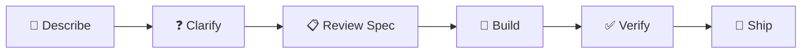

<p align="center">
  
</p>

<h1 align="center">Prazium</h1>

<p align="center">
  <strong>The AI-Powered Application Factory</strong>
</p>

<p align="center">
  Describe your app. Watch it build. Ship in minutes.
</p>

<p align="center">
  <a href="https://prazium.com">Website</a> •
  <a href="https://docs.prazium.com">Documentation</a> •
  <a href="https://github.com/prazium/prazium/discussions">Community</a>
</p>

<p align="center">
  
  
  
</p>

---

## What is Prazium?

Prazium transforms a simple product description into a **production-ready web application** using parallel AI agents. No coding required. No Git knowledge needed. Just describe what you want, and watch it come to life.

```
"A project management tool with team workspaces, kanban boards, and time tracking"
                                    ↓
                         [10 minutes later]
                                    ↓
                    🚀 Full Next.js app with Supabase backend
```

### Key Features

- 🤖 **AI-Powered Generation** — Parallel agents build your app simultaneously
- 👀 **Watch It Build** — Real-time progress with live file updates
- 🔒 **Secure Sandboxes** — All code runs in isolated Docker containers
- 📦 **Export Anywhere** — Download full source code, deploy anywhere
- 🏠 **Self-Hostable** — Run on your own infrastructure
- 🔄 **Deterministic Builds** — Reproducible from Git tags

---

## How It Works



1. **Describe** — Tell Prazium what you want to build
2. **Clarify** — Answer a few questions to refine requirements
3. **Review** — Approve the generated specification
4. **Build** — Watch parallel AI agents construct your app
5. **Verify** — Automated testing ensures quality
6. **Ship** — Export or deploy with one click

---

## Quick Start

### Using Docker (Recommended)

```bash
# Clone the repository
git clone https://github.com/prazium/prazium.git
cd prazium

# Configure environment
cp .env.example .env
# Edit .env with your LLM API key

# Start Prazium
docker compose up -d

# Open in browser
open http://localhost:3000
```

### Using the CLI

```bash
# Install CLI
pnpm add -g @prazium/cli

# Login
prazium login

# Create a new app
prazium new "My SaaS App"

# Watch it build
prazium build proj_xxx --watch

# Export when ready
prazium export proj_xxx
```

---

## Generated Stack

Every app built with Prazium includes:

| Layer | Technology |
|-------|------------|
| Framework | Next.js 15 (App Router) |
| UI | React 19 + Tailwind CSS |
| Database | Supabase (PostgreSQL) |
| Auth | Supabase Auth |
| Package Manager | pnpm |
| Deployment | Docker + Railway-ready |

---

## Architecture

```
┌─────────────────────────────────────────────────────────────┐
│                         Web UI                               │
│                    (Next.js + React)                         │
└─────────────────────────┬───────────────────────────────────┘
                          │
┌─────────────────────────▼───────────────────────────────────┐
│                    Orchestrator API                          │
│              (State Machine + Job Queue)                     │
└─────────────────────────┬───────────────────────────────────┘
                          │
        ┌─────────────────┼─────────────────┐
        │                 │                 │
┌───────▼───────┐ ┌───────▼───────┐ ┌───────▼───────┐
│   Worker 1    │ │   Worker 2    │ │   Worker N    │
│  ┌─────────┐  │ │  ┌─────────┐  │ │  ┌─────────┐  │
│  │ Sandbox │  │ │  │ Sandbox │  │ │  │ Sandbox │  │
│  │  Agent  │  │ │  │  Agent  │  │ │  │  Agent  │  │
│  └─────────┘  │ │  └─────────┘  │ │  └─────────┘  │
└───────────────┘ └───────────────┘ └───────────────┘
```

---

## Self-Hosting

Prazium is designed to run anywhere:

```yaml
# docker-compose.yml (simplified)
services:
  ui:
    image: prazium/ui:latest
    ports: ["3000:3000"]
    
  api:
    image: prazium/api:latest
    ports: ["3001:3001"]
    environment:
      - LLM_API_KEY=${LLM_API_KEY}
      
  worker:
    image: prazium/worker:latest
    volumes:
      - /var/run/docker.sock:/var/run/docker.sock
      
  postgres:
    image: postgres:16-alpine
    
  redis:
    image: redis:7-alpine
```

See the [Deployment Guide](docs/DEPLOYMENT.md) for production setup.

---

## Documentation

| Document | Description |
|----------|-------------|
| [Architecture](docs/ARCHITECTURE.md) | System design and components |
| [Database](docs/DATABASE.md) | Schema and data model |
| [API](docs/API.md) | REST API reference |
| [Events](docs/EVENTS.md) | Real-time event system |
| [Git Model](docs/GIT-MODEL.md) | Internal version control |
| [SDLC](docs/SDLC.md) | Build pipeline workflow |
| [Agents](docs/AGENTS.md) | AI agent execution |
| [Security](docs/SECURITY.md) | Security model |
| [Deployment](docs/DEPLOYMENT.md) | Hosting guide |
| [UI Spec](docs/UI-SPEC.md) | Interface design |
| [CLI](docs/CLI.md) | Command reference |

---

## Roadmap

### v1.0 (Current)
- ✅ Core build pipeline
- ✅ Parallel agent execution
- ✅ Real-time build watching
- ✅ Export bundles
- ✅ Docker sandbox isolation
- ✅ CLI tool

### v1.1
- 🔲 Preview deployments
- 🔲 Build caching
- 🔲 Custom templates

### v2.0
- 🔲 Visual editor
- 🔲 Plugin system
- 🔲 Team collaboration

---

## Contributing

We welcome contributions! See [CONTRIBUTING.md](CONTRIBUTING.md) for guidelines.

```bash
# Development setup
git clone https://github.com/prazium/prazium.git
cd prazium
pnpm install
pnpm dev
```

---

## Community

- 💬 [GitHub Discussions](https://github.com/prazium/prazium/discussions) — Questions and ideas
- 🐛 [GitHub Issues](https://github.com/prazium/prazium/issues) — Bug reports
- 🐦 [Twitter](https://twitter.com/praziumhq) — Updates and news

---

## License

MIT License — see [LICENSE](LICENSE) for details.

---

<p align="center">
  <strong>Built with ❤️ by the Prazium team</strong>
</p>

<p align="center">
  <a href="https://prazium.com">prazium.com</a>
</p>
