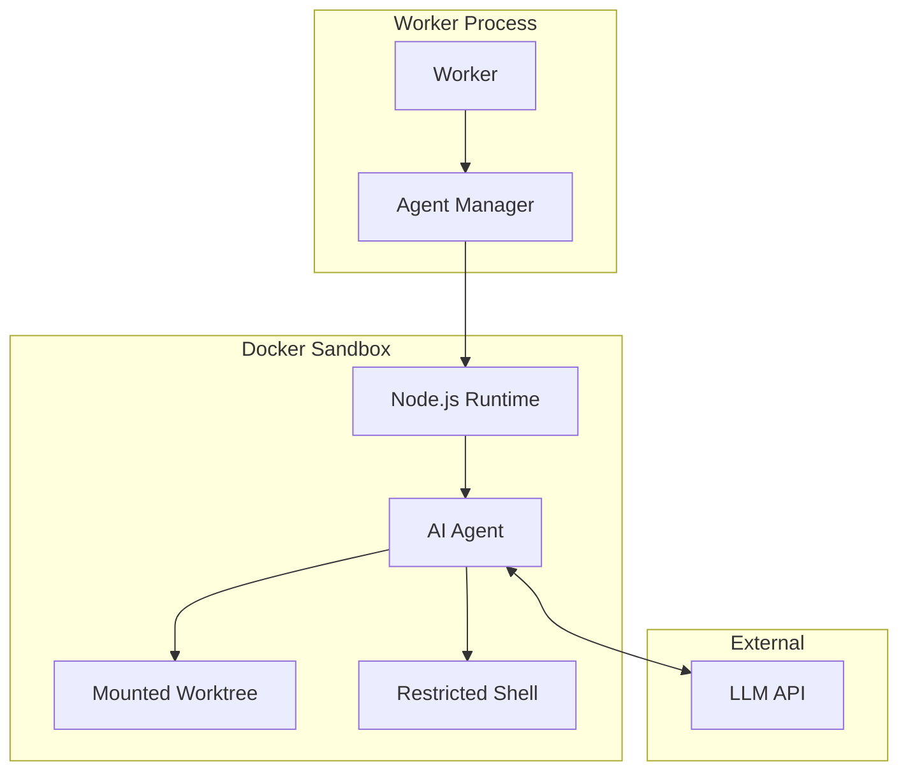
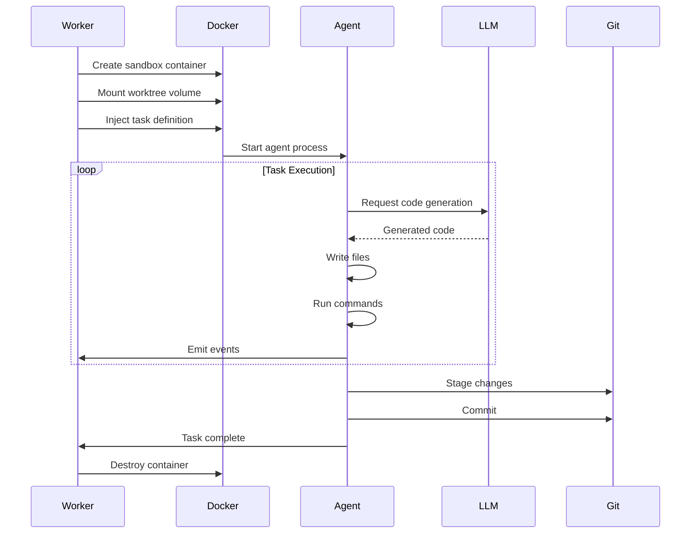

# Prazium Agent Execution Model

## Overview

Prazium uses AI agents to execute code generation tasks. Each agent operates in an isolated Docker sandbox with restricted capabilities, ensuring safe execution of untrusted generated code.

## Agent Architecture



---

## Agent Lifecycle



---

## Task Contract

### Task Definition

```typescript
interface TaskDefinition {
  id: string;
  slug: string;
  description: string;
  instructions: string;
  dependencies: string[];
  pathScope: string[];
  expectedOutputs: string[];
  acceptanceCriteria: string[];
  context: TaskContext;
}

interface TaskContext {
  projectName: string;
  stack: StackConfig;
  spec: {
    SPEC: string;
    ACCEPTANCE: string;
    ROUTES: string;
    DATA: string;
  };
  existingFiles: FileEntry[];
  environment: Record<string, string>;
}

interface StackConfig {
  framework: 'nextjs';
  frameworkVersion: '15';
  react: '19';
  packageManager: 'pnpm';
  styling: 'tailwind';
  database: 'supabase';
  auth: 'supabase';
}

interface FileEntry {
  path: string;
  content: string;
  language: string;
}
```

### Task Result

```typescript
interface TaskResult {
  status: 'succeeded' | 'failed';
  filesCreated: string[];
  filesModified: string[];
  filesDeleted: string[];
  commitSha: string;
  duration: number;
  error?: TaskError;
  logs: string;
}

interface TaskError {
  code: string;
  message: string;
  stack?: string;
  recoverable: boolean;
}
```

---

## Agent Capabilities

### Allowed Operations

| Operation | Description | Constraints |
|-----------|-------------|-------------|
| Read files | Read any file in worktree | Within worktree only |
| Write files | Create/modify files | Within path scope only |
| Delete files | Remove files | Within path scope only |
| Run commands | Execute shell commands | Allowlisted commands only |
| HTTP requests | Call LLM API | LLM endpoint only |

### Prohibited Operations

| Operation | Reason |
|-----------|--------|
| Network access | Security isolation |
| Host filesystem | Sandbox escape prevention |
| Process spawning | Resource control |
| Privilege escalation | Security |
| Modify dependencies | Version control |

---

## Sandbox Configuration

### Docker Container Spec

```yaml
# sandbox.dockerfile
FROM node:20-slim

# Install required tools
RUN apt-get update && apt-get install -y \
    git \
    && rm -rf /var/lib/apt/lists/*

# Install pnpm
RUN corepack enable && corepack prepare pnpm@latest --activate

# Create non-root user
RUN useradd -m -s /bin/bash agent
USER agent

WORKDIR /workspace

# Agent runtime
COPY --chown=agent:agent agent-runtime /opt/agent
```

### Container Runtime Config

```typescript
interface SandboxConfig {
  image: string;
  resources: ResourceLimits;
  network: NetworkConfig;
  mounts: MountConfig[];
  environment: Record<string, string>;
  securityOpts: string[];
}

interface ResourceLimits {
  cpus: number;          // 2
  memory: string;        // '4g'
  memorySwap: string;    // '4g' (no swap)
  pidsLimit: number;     // 100
  diskQuota: string;     // '10g'
}

interface NetworkConfig {
  mode: 'none' | 'bridge';
  allowedHosts?: string[];  // Only LLM API endpoint
}

interface MountConfig {
  source: string;
  target: string;
  readonly: boolean;
}
```

### Docker Run Command

```bash
docker run \
  --rm \
  --name prazium-agent-${taskId} \
  --cpus=2 \
  --memory=4g \
  --memory-swap=4g \
  --pids-limit=100 \
  --network=none \
  --security-opt=no-new-privileges \
  --read-only \
  --tmpfs /tmp:size=1g \
  -v ${worktreePath}:/workspace:rw \
  -v ${agentRuntime}:/opt/agent:ro \
  -e TASK_DEFINITION="${taskJson}" \
  -e LLM_API_KEY="${llmApiKey}" \
  prazium/agent:latest \
  node /opt/agent/main.js
```

---

## Agent Runtime

### Main Loop

```typescript
// /opt/agent/main.js
import { Agent } from './agent';
import { TaskDefinition } from './types';

async function main() {
  const taskDef: TaskDefinition = JSON.parse(
    process.env.TASK_DEFINITION!
  );
  
  const agent = new Agent({
    taskDefinition: taskDef,
    workspacePath: '/workspace',
    llmApiKey: process.env.LLM_API_KEY!,
  });
  
  try {
    const result = await agent.execute();
    console.log(JSON.stringify({ type: 'result', data: result }));
    process.exit(0);
  } catch (error) {
    console.log(JSON.stringify({ type: 'error', data: error }));
    process.exit(1);
  }
}

main();
```

### Agent Class

```typescript
class Agent {
  private task: TaskDefinition;
  private workspace: string;
  private llm: LLMClient;
  private eventEmitter: EventEmitter;
  
  constructor(config: AgentConfig) {
    this.task = config.taskDefinition;
    this.workspace = config.workspacePath;
    this.llm = new LLMClient(config.llmApiKey);
    this.eventEmitter = new EventEmitter();
  }
  
  async execute(): Promise<TaskResult> {
    this.emit('TASK_STARTED', { slug: this.task.slug });
    
    // Build context for LLM
    const context = await this.buildContext();
    
    // Generate implementation plan
    const plan = await this.generatePlan(context);
    
    // Execute plan steps
    for (const step of plan.steps) {
      await this.executeStep(step);
    }
    
    // Validate outputs
    await this.validateOutputs();
    
    // Commit changes
    const commitSha = await this.commitChanges();
    
    this.emit('TASK_COMPLETED', { commitSha });
    
    return this.buildResult(commitSha);
  }
  
  private async executeStep(step: PlanStep): Promise<void> {
    switch (step.type) {
      case 'write_file':
        await this.writeFile(step.path, step.content);
        break;
      case 'modify_file':
        await this.modifyFile(step.path, step.changes);
        break;
      case 'run_command':
        await this.runCommand(step.command);
        break;
    }
  }
  
  private async writeFile(path: string, content: string): Promise<void> {
    // Validate path is within scope
    if (!this.isPathAllowed(path)) {
      throw new PathScopeError(`Path ${path} outside task scope`);
    }
    
    const fullPath = join(this.workspace, path);
    await fs.mkdir(dirname(fullPath), { recursive: true });
    await fs.writeFile(fullPath, content);
    
    this.emit('FILE_CREATED', { path, size: content.length });
  }
  
  private isPathAllowed(path: string): boolean {
    return this.task.pathScope.some(pattern => 
      minimatch(path, pattern)
    );
  }
}
```

---

## LLM Integration

### Prompt Structure

```typescript
interface AgentPrompt {
  system: string;
  context: ContextSection[];
  task: TaskSection;
  constraints: string[];
  outputFormat: string;
}

const systemPrompt = `
You are a code generation agent for Prazium.
Your task is to implement a specific feature according to the specification.

Rules:
1. Only modify files within your assigned path scope
2. Follow the existing code style and patterns
3. Write clean, well-documented code
4. Include error handling
5. Do not modify package.json dependencies unless explicitly instructed
6. Use TypeScript with strict mode
7. Follow React best practices for components
`;
```

### Context Building

```typescript
async function buildContext(): Promise<ContextSection[]> {
  return [
    {
      title: 'Project Specification',
      content: this.task.context.spec.SPEC,
    },
    {
      title: 'Acceptance Criteria',
      content: this.task.context.spec.ACCEPTANCE,
    },
    {
      title: 'API Routes',
      content: this.task.context.spec.ROUTES,
    },
    {
      title: 'Data Model',
      content: this.task.context.spec.DATA,
    },
    {
      title: 'Existing Files',
      content: this.formatExistingFiles(),
    },
    {
      title: 'Stack Configuration',
      content: JSON.stringify(this.task.context.stack, null, 2),
    },
  ];
}
```

### Response Parsing

```typescript
interface LLMResponse {
  plan: {
    steps: PlanStep[];
  };
  files: GeneratedFile[];
  commands: string[];
}

interface PlanStep {
  type: 'write_file' | 'modify_file' | 'run_command';
  description: string;
  path?: string;
  content?: string;
  changes?: FileChange[];
  command?: string;
}

interface GeneratedFile {
  path: string;
  content: string;
  language: string;
}
```

---

## Command Execution

### Allowed Commands

```typescript
const ALLOWED_COMMANDS = [
  'pnpm install',
  'pnpm add',
  'pnpm remove',
  'pnpm run',
  'pnpm exec',
  'npx',
  'tsc',
  'eslint',
  'prettier',
  'vitest',
  'git add',
  'git commit',
  'git status',
  'git diff',
  'mkdir',
  'rm',
  'cp',
  'mv',
  'cat',
  'echo',
  'ls',
];

function isCommandAllowed(command: string): boolean {
  const baseCommand = command.split(' ')[0];
  return ALLOWED_COMMANDS.some(allowed => 
    command.startsWith(allowed)
  );
}
```

### Command Execution

```typescript
async function runCommand(command: string): Promise<CommandResult> {
  if (!isCommandAllowed(command)) {
    throw new CommandNotAllowedError(command);
  }
  
  this.emit('COMMAND_STARTED', { command });
  
  const result = await exec(command, {
    cwd: this.workspace,
    timeout: 300000, // 5 minutes
    maxBuffer: 10 * 1024 * 1024, // 10MB
  });
  
  this.emit('COMMAND_OUTPUT', { 
    stdout: result.stdout,
    stderr: result.stderr,
  });
  
  this.emit('COMMAND_COMPLETED', { 
    exitCode: result.exitCode,
    duration: result.duration,
  });
  
  return result;
}
```

---

## Path Scope Enforcement

### Validation

```typescript
import { minimatch } from 'minimatch';

class PathValidator {
  private patterns: string[];
  
  constructor(pathScope: string[]) {
    this.patterns = pathScope;
  }
  
  isAllowed(path: string): boolean {
    // Normalize path
    const normalized = path.replace(/^\//, '').replace(/\/$/, '');
    
    // Check against patterns
    return this.patterns.some(pattern => 
      minimatch(normalized, pattern, { dot: true })
    );
  }
  
  validateAll(paths: string[]): ValidationResult {
    const violations = paths.filter(p => !this.isAllowed(p));
    return {
      valid: violations.length === 0,
      violations,
    };
  }
}
```

### Pre-Commit Hook

```typescript
async function validateCommit(): Promise<void> {
  // Get staged files
  const { stdout } = await exec('git diff --cached --name-only');
  const stagedFiles = stdout.trim().split('\n').filter(Boolean);
  
  // Validate all files
  const validator = new PathValidator(this.task.pathScope);
  const result = validator.validateAll(stagedFiles);
  
  if (!result.valid) {
    throw new PathScopeViolationError(
      `Files outside scope: ${result.violations.join(', ')}`
    );
  }
}
```

---

## Event Emission

### Event Types

```typescript
type AgentEvent = 
  | { type: 'TASK_STARTED'; payload: { slug: string } }
  | { type: 'TASK_PROGRESS'; payload: { phase: string; message: string } }
  | { type: 'FILE_CREATED'; payload: { path: string; size: number } }
  | { type: 'FILE_MODIFIED'; payload: { path: string; linesChanged: number } }
  | { type: 'FILE_DELETED'; payload: { path: string } }
  | { type: 'COMMAND_STARTED'; payload: { command: string } }
  | { type: 'COMMAND_OUTPUT'; payload: { stdout: string; stderr: string } }
  | { type: 'COMMAND_COMPLETED'; payload: { exitCode: number; duration: number } }
  | { type: 'TASK_COMPLETED'; payload: { commitSha: string } }
  | { type: 'TASK_FAILED'; payload: { error: string; code: string } };
```

### Event Streaming

```typescript
class EventEmitter {
  emit(event: AgentEvent): void {
    // Write to stdout for worker to capture
    console.log(JSON.stringify({
      type: 'event',
      timestamp: new Date().toISOString(),
      ...event,
    }));
  }
}
```

---

## Error Handling

### Error Types

```typescript
class AgentError extends Error {
  code: string;
  recoverable: boolean;
  
  constructor(message: string, code: string, recoverable = false) {
    super(message);
    this.code = code;
    this.recoverable = recoverable;
  }
}

class PathScopeViolationError extends AgentError {
  constructor(message: string) {
    super(message, 'PATH_SCOPE_VIOLATION', false);
  }
}

class CommandNotAllowedError extends AgentError {
  constructor(command: string) {
    super(`Command not allowed: ${command}`, 'COMMAND_NOT_ALLOWED', false);
  }
}

class LLMError extends AgentError {
  constructor(message: string) {
    super(message, 'LLM_ERROR', true);
  }
}

class TimeoutError extends AgentError {
  constructor(operation: string) {
    super(`Operation timed out: ${operation}`, 'TIMEOUT', true);
  }
}
```

### Retry Logic

```typescript
async function withRetry<T>(
  operation: () => Promise<T>,
  options: RetryOptions
): Promise<T> {
  let lastError: Error;
  
  for (let attempt = 1; attempt <= options.maxAttempts; attempt++) {
    try {
      return await operation();
    } catch (error) {
      lastError = error as Error;
      
      if (error instanceof AgentError && !error.recoverable) {
        throw error;
      }
      
      if (attempt < options.maxAttempts) {
        const delay = options.baseDelay * Math.pow(2, attempt - 1);
        await sleep(delay);
      }
    }
  }
  
  throw lastError!;
}
```

---

## Resource Management

### Memory Limits

```typescript
// Monitor memory usage
const memoryMonitor = setInterval(() => {
  const usage = process.memoryUsage();
  if (usage.heapUsed > 3.5 * 1024 * 1024 * 1024) { // 3.5GB
    console.error('Memory limit approaching');
    // Trigger garbage collection if available
    if (global.gc) global.gc();
  }
}, 10000);
```

### Timeout Management

```typescript
const TIMEOUTS = {
  llmRequest: 120000,    // 2 minutes
  command: 300000,       // 5 minutes
  fileOperation: 30000,  // 30 seconds
  totalTask: 1800000,    // 30 minutes
};

async function withTimeout<T>(
  promise: Promise<T>,
  ms: number,
  operation: string
): Promise<T> {
  const timeout = new Promise<never>((_, reject) => {
    setTimeout(() => reject(new TimeoutError(operation)), ms);
  });
  
  return Promise.race([promise, timeout]);
}
```

---

## Testing Agents

### Unit Testing

```typescript
describe('Agent', () => {
  it('should respect path scope', async () => {
    const agent = new Agent({
      taskDefinition: {
        pathScope: ['src/components/**'],
        // ...
      },
    });
    
    await expect(
      agent.writeFile('src/lib/utils.ts', 'content')
    ).rejects.toThrow(PathScopeViolationError);
  });
  
  it('should reject disallowed commands', async () => {
    const agent = new Agent({ /* ... */ });
    
    await expect(
      agent.runCommand('curl http://evil.com')
    ).rejects.toThrow(CommandNotAllowedError);
  });
});
```

### Integration Testing

```typescript
describe('Agent Integration', () => {
  it('should complete task in sandbox', async () => {
    const result = await runAgentInSandbox({
      taskDefinition: mockTask,
      worktreePath: '/tmp/test-worktree',
    });
    
    expect(result.status).toBe('succeeded');
    expect(result.filesCreated).toContain('src/components/Button.tsx');
  });
});
```

---

## Monitoring

### Metrics

| Metric | Description |
|--------|-------------|
| `agent_task_duration` | Time to complete task |
| `agent_llm_requests` | Number of LLM API calls |
| `agent_files_created` | Files created per task |
| `agent_commands_run` | Commands executed per task |
| `agent_errors` | Error count by type |
| `agent_memory_usage` | Peak memory usage |

### Logging

```typescript
const logger = {
  info: (msg: string, meta?: object) => 
    console.log(JSON.stringify({ level: 'info', msg, ...meta })),
  error: (msg: string, meta?: object) => 
    console.error(JSON.stringify({ level: 'error', msg, ...meta })),
  debug: (msg: string, meta?: object) => 
    console.log(JSON.stringify({ level: 'debug', msg, ...meta })),
};
```

---

## Related Documentation

- [Architecture Overview](./ARCHITECTURE.md)
- [SDLC Workflow](./SDLC.md)
- [Security Model](./SECURITY.md)
- [Event System](./EVENTS.md)
