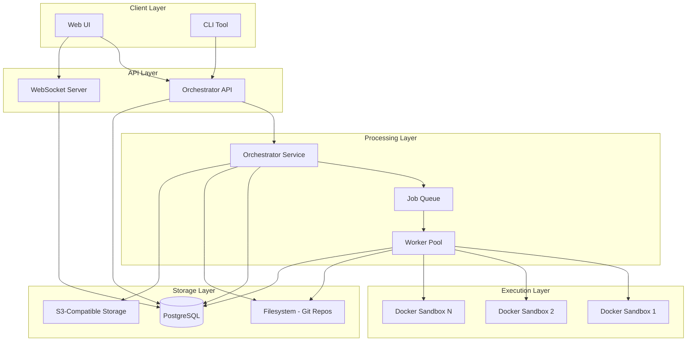
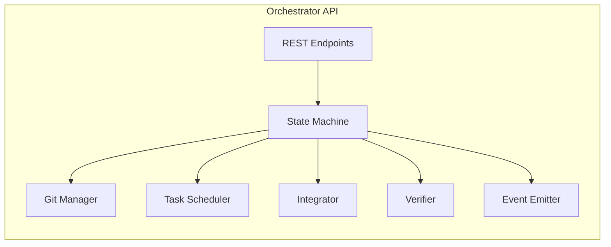
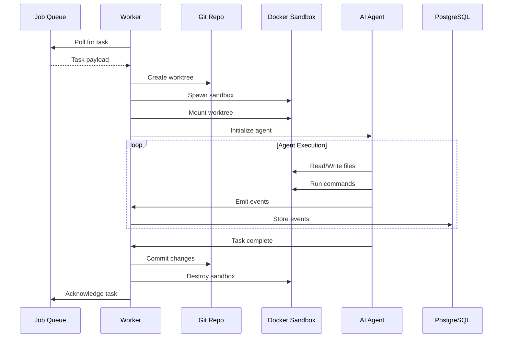
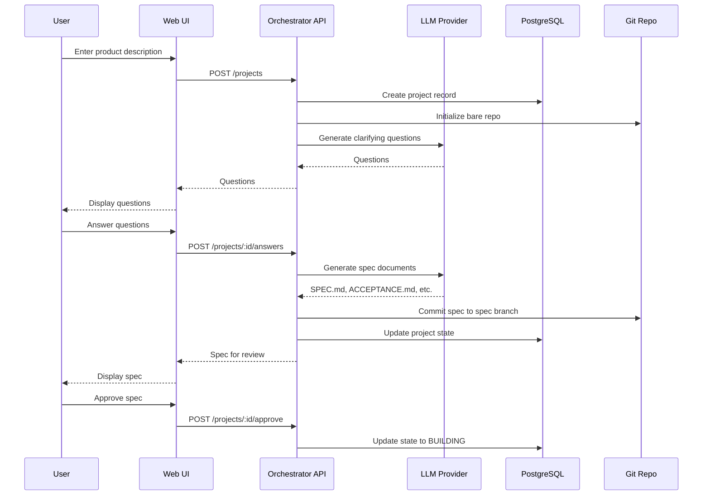
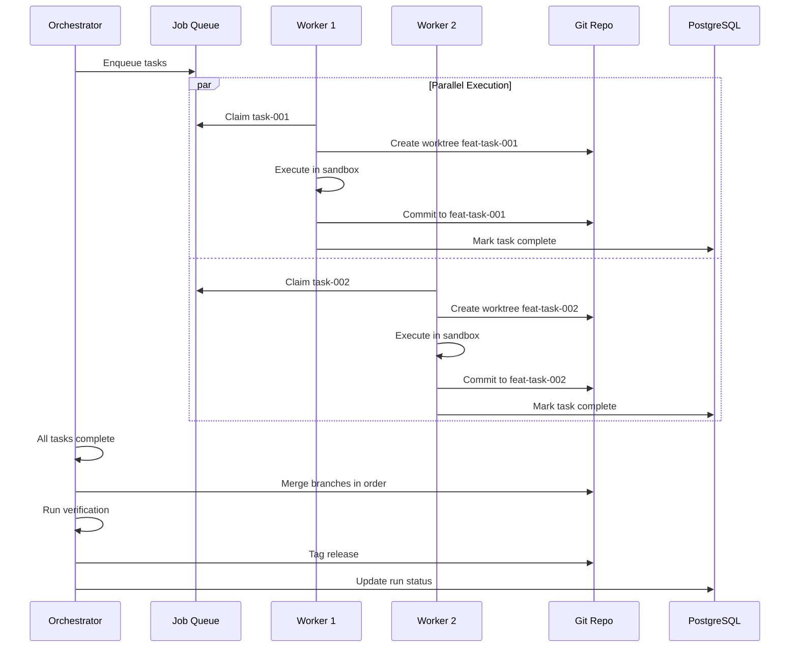
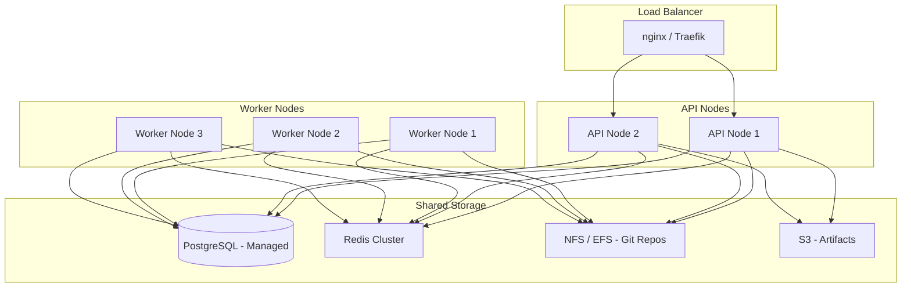
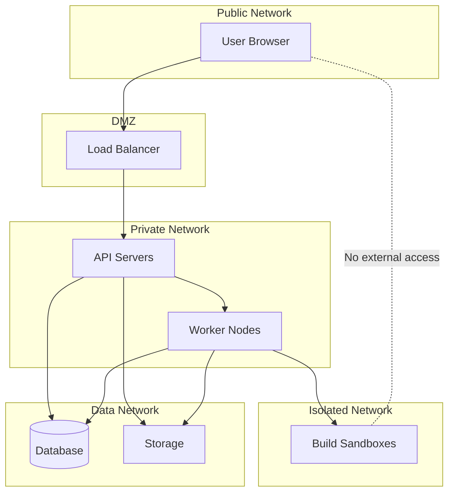

# Prazium Architecture

## Overview

Prazium is a distributed system composed of four primary components that work together to transform product descriptions into production-ready applications.

## System Components



## Component Details

### 1. Web UI

**Purpose**: User-facing interface for app creation and monitoring

**Responsibilities**:
- Product description intake form
- Clarifying question wizard
- Spec review and approval interface
- Live build watcher dashboard
- Export and deploy controls
- Project management

**Technology**: Next.js App Router, React 19, Tailwind CSS

**Key Pages**:
| Route | Purpose |
|-------|---------|
| `/` | Landing / Dashboard |
| `/new` | New product wizard |
| `/projects` | Project list |
| `/projects/[id]` | Project detail |
| `/projects/[id]/runs/[runId]` | Build run watcher |
| `/projects/[id]/export` | Export controls |

---

### 2. Orchestrator API

**Purpose**: Central control plane for all operations

**Responsibilities**:
- SDLC state machine management
- Internal Git repository lifecycle
- Task decomposition and scheduling
- Branch merging and integration
- Verification gate execution
- Event emission for watchers

**Technology**: Node.js, Express/Fastify, TypeScript

**Key Modules**:



---

### 3. Worker / Runner

**Purpose**: Execute agent tasks in isolated environments

**Responsibilities**:
- Pull tasks from job queue
- Create and manage Git worktrees
- Spawn Docker sandboxes
- Execute AI agents within sandboxes
- Capture diffs, logs, and events
- Commit changes to task branches

**Technology**: Node.js, Docker SDK, TypeScript

**Worker Lifecycle**:



---

### 4. Storage Layer

#### PostgreSQL

**Purpose**: Persistent structured data

**Stores**:
- Projects and metadata
- Build runs and state
- Tasks and status
- Events and logs
- User data (hosted mode)

#### Filesystem (Git Repos)

**Purpose**: Source code and version control

**Structure**:
```
data/
├── repos/
│   ├── <productId-1>.git    # Bare repository
│   ├── <productId-2>.git
│   └── ...
└── workspaces/
    ├── <productId-1>/
    │   ├── main/            # Main branch checkout
    │   └── wt/
    │       ├── feat-task-001/
    │       └── feat-task-002/
    └── <productId-2>/
        └── ...
```

#### S3-Compatible Storage (Optional)

**Purpose**: Artifact storage

**Stores**:
- Export bundles (zip/tarball)
- Build artifacts
- Docker images (if not using registry)

---

## Data Flow

### New Product Flow



### Build Execution Flow



---

## Deployment Architecture

### Self-Hosted (Single Node)

```mermaid
graph TB
    subgraph Docker Host
        subgraph App Containers
            UI[Web UI Container]
            API[API Container]
            WORKER[Worker Container]
        end
        
        subgraph Infrastructure
            PG[(PostgreSQL)]
            REDIS[Redis - Queue]
        end
        
        subgraph Volumes
            DATA[/data - Git Repos]
            PGDATA[/pgdata]
        end
        
        subgraph Build Sandboxes
            SB1[Sandbox 1]
            SB2[Sandbox 2]
        end
    end

    UI --> API
    API --> PG
    API --> REDIS
    API --> DATA
    WORKER --> REDIS
    WORKER --> DATA
    WORKER --> PG
    WORKER -.-> SB1
    WORKER -.-> SB2
    PG --> PGDATA
```

### Hosted (Multi-Node)



---

## Technology Stack

| Component | Technology | Rationale |
|-----------|------------|-----------|
| Web UI | Next.js 15, React 19 | SSR, App Router, modern React |
| API | Node.js, Fastify | Performance, TypeScript support |
| Queue | BullMQ + Redis | Reliable job processing |
| Database | PostgreSQL 16 | JSONB, reliability, ecosystem |
| Git Operations | isomorphic-git + libgit2 | Pure JS + native performance |
| Containers | Docker Engine API | Industry standard, isolation |
| Real-time | WebSocket / SSE | Live updates |
| LLM | OpenAI / Anthropic API | Agent intelligence |

---

## Scalability Considerations

### Horizontal Scaling

| Component | Scaling Strategy |
|-----------|------------------|
| Web UI | Stateless, scale behind LB |
| API | Stateless, scale behind LB |
| Workers | Add nodes, share queue |
| PostgreSQL | Read replicas, connection pooling |
| Git Repos | NFS/EFS for shared access |

### Resource Limits

| Resource | Default Limit |
|----------|---------------|
| Sandbox CPU | 2 cores |
| Sandbox Memory | 4GB |
| Sandbox Disk | 10GB |
| Build Timeout | 30 minutes |
| Concurrent Tasks | 4 per worker |

---

## Network Architecture



**Key Security Boundaries**:
1. Sandboxes have no host networking
2. Sandboxes cannot reach external services (except LLM API via proxy)
3. Database is not accessible from sandboxes
4. Workers communicate with sandboxes via Docker API only

---

## Failure Modes and Recovery

| Failure | Detection | Recovery |
|---------|-----------|----------|
| Worker crash | Heartbeat timeout | Task re-queued |
| Sandbox timeout | Build timeout | Task failed, cleanup |
| Database unavailable | Connection error | Retry with backoff |
| Git corruption | Integrity check | Restore from backup |
| LLM API down | API error | Retry with backoff |

---

## Monitoring Points

| Metric | Source | Alert Threshold |
|--------|--------|-----------------|
| Build queue depth | Redis | > 100 pending |
| Build success rate | PostgreSQL | < 90% |
| Worker utilization | Worker metrics | > 80% sustained |
| Sandbox spawn time | Worker metrics | > 30s |
| API latency p99 | API metrics | > 500ms |

---

## Related Documentation

- [Database Schema](./DATABASE.md)
- [API Specification](./API.md)
- [Event System](./EVENTS.md)
- [Git Model](./GIT-MODEL.md)
- [SDLC Workflow](./SDLC.md)
- [Security Model](./SECURITY.md)
