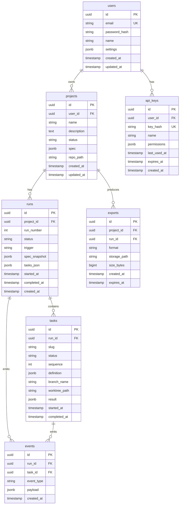

# Prazium Database Schema

## Overview

Prazium uses PostgreSQL as its primary data store for all structured data including projects, builds, tasks, and events. Git repositories are stored on the filesystem, not in the database.

## Entity Relationship Diagram



---

## Tables

### users

Stores user accounts (hosted mode only; self-hosted uses local admin).

```sql
CREATE TABLE users (
    id UUID PRIMARY KEY DEFAULT gen_random_uuid(),
    email VARCHAR(255) NOT NULL UNIQUE,
    password_hash VARCHAR(255) NOT NULL,
    name VARCHAR(255),
    settings JSONB DEFAULT '{}',
    created_at TIMESTAMPTZ NOT NULL DEFAULT NOW(),
    updated_at TIMESTAMPTZ NOT NULL DEFAULT NOW()
);

CREATE INDEX idx_users_email ON users(email);
```

**Settings JSONB Structure**:
```json
{
  "theme": "dark",
  "notifications": {
    "email": true,
    "buildComplete": true,
    "buildFailed": true
  },
  "defaultStack": "nextjs-supabase"
}
```

---

### projects

Core entity representing a product being built.

```sql
CREATE TABLE projects (
    id UUID PRIMARY KEY DEFAULT gen_random_uuid(),
    user_id UUID REFERENCES users(id) ON DELETE CASCADE,
    name VARCHAR(255) NOT NULL,
    description TEXT,
    status VARCHAR(50) NOT NULL DEFAULT 'draft',
    spec JSONB,
    repo_path VARCHAR(500) NOT NULL UNIQUE,
    created_at TIMESTAMPTZ NOT NULL DEFAULT NOW(),
    updated_at TIMESTAMPTZ NOT NULL DEFAULT NOW()
);

CREATE INDEX idx_projects_user_id ON projects(user_id);
CREATE INDEX idx_projects_status ON projects(status);
CREATE INDEX idx_projects_created_at ON projects(created_at DESC);
```

**Status Values**:
| Status | Description |
|--------|-------------|
| `draft` | Initial state, description entered |
| `clarifying` | Awaiting answers to questions |
| `spec_review` | Spec generated, awaiting approval |
| `approved` | Spec approved, ready to build |
| `building` | Build in progress |
| `completed` | At least one successful build |
| `failed` | Last build failed |
| `archived` | Soft deleted |

**Spec JSONB Structure**:
```json
{
  "version": 1,
  "description": "Original user description",
  "clarifications": [
    {"question": "...", "answer": "..."}
  ],
  "documents": {
    "SPEC.md": "...",
    "ACCEPTANCE.md": "...",
    "ROUTES.md": "...",
    "DATA.md": "..."
  },
  "approvedAt": "2024-01-15T10:30:00Z",
  "approvedBy": "user-uuid"
}
```

---

### runs

Represents a single build execution attempt.

```sql
CREATE TABLE runs (
    id UUID PRIMARY KEY DEFAULT gen_random_uuid(),
    project_id UUID NOT NULL REFERENCES projects(id) ON DELETE CASCADE,
    run_number INT NOT NULL,
    status VARCHAR(50) NOT NULL DEFAULT 'pending',
    trigger VARCHAR(50) NOT NULL DEFAULT 'manual',
    spec_snapshot JSONB NOT NULL,
    tasks_json JSONB NOT NULL,
    verification_result JSONB,
    started_at TIMESTAMPTZ,
    completed_at TIMESTAMPTZ,
    created_at TIMESTAMPTZ NOT NULL DEFAULT NOW(),
    
    UNIQUE(project_id, run_number)
);

CREATE INDEX idx_runs_project_id ON runs(project_id);
CREATE INDEX idx_runs_status ON runs(status);
CREATE INDEX idx_runs_created_at ON runs(created_at DESC);
```

**Status Values**:
| Status | Description |
|--------|-------------|
| `pending` | Created, not started |
| `decomposing` | Generating tasks |
| `executing` | Tasks running |
| `integrating` | Merging branches |
| `verifying` | Running verification |
| `fixing` | Auto-fix in progress |
| `succeeded` | Build passed |
| `failed` | Build failed |
| `cancelled` | User cancelled |

**Trigger Values**:
| Trigger | Description |
|---------|-------------|
| `manual` | User initiated |
| `retry` | Retry of failed build |
| `fix` | Auto-fix attempt |
| `rebuild` | Rebuild from spec |

**Tasks JSON Structure**:
```json
{
  "version": 1,
  "tasks": [
    {
      "id": "task-001",
      "slug": "ui-shell",
      "description": "Create Next.js app shell with layout",
      "dependencies": [],
      "pathScope": ["src/app/**", "src/components/layout/**"],
      "sequence": 1
    }
  ],
  "mergeOrder": ["task-001", "task-002", "task-003"]
}
```

**Verification Result JSONB**:
```json
{
  "lint": {"passed": true, "output": "..."},
  "test": {"passed": true, "output": "...", "coverage": 85},
  "build": {"passed": true, "output": "..."},
  "acceptance": {"passed": true, "checks": [...]}
}
```

---

### tasks

Individual work units executed by agents.

```sql
CREATE TABLE tasks (
    id UUID PRIMARY KEY DEFAULT gen_random_uuid(),
    run_id UUID NOT NULL REFERENCES runs(id) ON DELETE CASCADE,
    slug VARCHAR(100) NOT NULL,
    status VARCHAR(50) NOT NULL DEFAULT 'pending',
    sequence INT NOT NULL,
    definition JSONB NOT NULL,
    branch_name VARCHAR(255),
    worktree_path VARCHAR(500),
    result JSONB,
    started_at TIMESTAMPTZ,
    completed_at TIMESTAMPTZ,
    created_at TIMESTAMPTZ NOT NULL DEFAULT NOW(),
    
    UNIQUE(run_id, slug)
);

CREATE INDEX idx_tasks_run_id ON tasks(run_id);
CREATE INDEX idx_tasks_status ON tasks(status);
CREATE INDEX idx_tasks_sequence ON tasks(run_id, sequence);
```

**Status Values**:
| Status | Description |
|--------|-------------|
| `pending` | Not started |
| `queued` | In job queue |
| `running` | Agent executing |
| `succeeded` | Completed successfully |
| `failed` | Agent failed |
| `skipped` | Skipped due to dependency failure |

**Definition JSONB Structure**:
```json
{
  "id": "task-001",
  "slug": "ui-shell",
  "description": "Create Next.js app shell with layout",
  "instructions": "Detailed agent instructions...",
  "dependencies": [],
  "pathScope": ["src/app/**", "src/components/layout/**"],
  "expectedOutputs": ["src/app/layout.tsx", "src/app/page.tsx"],
  "acceptanceCriteria": ["App renders without errors"]
}
```

**Result JSONB Structure**:
```json
{
  "filesCreated": ["src/app/layout.tsx", "src/app/page.tsx"],
  "filesModified": [],
  "filesDeleted": [],
  "commitSha": "abc123...",
  "agentLogs": "...",
  "error": null
}
```

---

### events

Audit log and real-time event stream.

```sql
CREATE TABLE events (
    id UUID PRIMARY KEY DEFAULT gen_random_uuid(),
    run_id UUID NOT NULL REFERENCES runs(id) ON DELETE CASCADE,
    task_id UUID REFERENCES tasks(id) ON DELETE CASCADE,
    event_type VARCHAR(50) NOT NULL,
    payload JSONB NOT NULL DEFAULT '{}',
    created_at TIMESTAMPTZ NOT NULL DEFAULT NOW()
);

CREATE INDEX idx_events_run_id ON events(run_id);
CREATE INDEX idx_events_task_id ON events(task_id);
CREATE INDEX idx_events_type ON events(event_type);
CREATE INDEX idx_events_created_at ON events(created_at DESC);

-- Partitioning for high-volume deployments
-- CREATE TABLE events (...) PARTITION BY RANGE (created_at);
```

**Event Types**:
| Type | Description |
|------|-------------|
| `SPEC_CREATED` | Spec documents generated |
| `SPEC_APPROVED` | User approved spec |
| `RUN_STARTED` | Build run began |
| `RUN_COMPLETED` | Build run finished |
| `TASK_QUEUED` | Task added to queue |
| `TASK_STARTED` | Agent began execution |
| `TASK_COMPLETED` | Agent finished |
| `FILE_CREATED` | New file written |
| `FILE_MODIFIED` | Existing file changed |
| `FILE_DELETED` | File removed |
| `COMMAND_STARTED` | Shell command began |
| `COMMAND_OUTPUT` | Command stdout/stderr |
| `COMMAND_COMPLETED` | Command finished |
| `MERGE_STARTED` | Branch merge began |
| `MERGE_COMPLETED` | Branch merge finished |
| `MERGE_CONFLICT` | Merge conflict detected |
| `VERIFY_STARTED` | Verification began |
| `VERIFY_LINT` | Lint result |
| `VERIFY_TEST` | Test result |
| `VERIFY_BUILD` | Build result |
| `VERIFY_COMPLETED` | Verification finished |
| `DEPLOY_STARTED` | Deployment began |
| `DEPLOY_COMPLETED` | Deployment finished |
| `EXPORT_CREATED` | Export bundle created |

---

### exports

Tracks exported build artifacts.

```sql
CREATE TABLE exports (
    id UUID PRIMARY KEY DEFAULT gen_random_uuid(),
    project_id UUID NOT NULL REFERENCES projects(id) ON DELETE CASCADE,
    run_id UUID REFERENCES runs(id) ON DELETE SET NULL,
    format VARCHAR(20) NOT NULL,
    storage_path VARCHAR(500) NOT NULL,
    size_bytes BIGINT NOT NULL,
    checksum VARCHAR(64),
    created_at TIMESTAMPTZ NOT NULL DEFAULT NOW(),
    expires_at TIMESTAMPTZ
);

CREATE INDEX idx_exports_project_id ON exports(project_id);
CREATE INDEX idx_exports_created_at ON exports(created_at DESC);
```

**Format Values**:
| Format | Description |
|--------|-------------|
| `zip` | ZIP archive |
| `tar.gz` | Gzipped tarball |
| `docker` | Docker image reference |

---

### api_keys

API authentication for programmatic access.

```sql
CREATE TABLE api_keys (
    id UUID PRIMARY KEY DEFAULT gen_random_uuid(),
    user_id UUID NOT NULL REFERENCES users(id) ON DELETE CASCADE,
    key_hash VARCHAR(64) NOT NULL UNIQUE,
    key_prefix VARCHAR(8) NOT NULL,
    name VARCHAR(100) NOT NULL,
    permissions JSONB NOT NULL DEFAULT '["read"]',
    last_used_at TIMESTAMPTZ,
    expires_at TIMESTAMPTZ,
    created_at TIMESTAMPTZ NOT NULL DEFAULT NOW()
);

CREATE INDEX idx_api_keys_user_id ON api_keys(user_id);
CREATE INDEX idx_api_keys_key_hash ON api_keys(key_hash);
```

**Permissions Array**:
```json
["read", "write", "build", "deploy", "export", "admin"]
```

---

## Job Queue Schema (BullMQ/Redis)

Jobs are stored in Redis, not PostgreSQL. This documents the job payload structures.

### Task Execution Job

**Queue Name**: `prazium:tasks`

```json
{
  "name": "execute-task",
  "data": {
    "taskId": "uuid",
    "runId": "uuid",
    "projectId": "uuid",
    "definition": {
      "slug": "ui-shell",
      "instructions": "...",
      "pathScope": ["src/app/**"]
    },
    "repoPath": "/data/repos/project-id.git",
    "worktreePath": "/data/workspaces/project-id/wt/feat-task-001",
    "branchName": "feat/task-001-ui-shell"
  },
  "opts": {
    "attempts": 3,
    "backoff": {
      "type": "exponential",
      "delay": 5000
    },
    "timeout": 1800000
  }
}
```

### Integration Job

**Queue Name**: `prazium:integration`

```json
{
  "name": "integrate-branches",
  "data": {
    "runId": "uuid",
    "projectId": "uuid",
    "repoPath": "/data/repos/project-id.git",
    "branches": [
      "feat/task-001-ui-shell",
      "feat/task-002-auth",
      "feat/task-003-api"
    ],
    "targetBranch": "main"
  }
}
```

### Verification Job

**Queue Name**: `prazium:verification`

```json
{
  "name": "verify-build",
  "data": {
    "runId": "uuid",
    "projectId": "uuid",
    "repoPath": "/data/repos/project-id.git",
    "workspacePath": "/data/workspaces/project-id/main",
    "checks": ["lint", "test", "build", "acceptance"]
  }
}
```

---

## Migrations

### Initial Migration (001_initial.sql)

```sql
-- Enable UUID extension
CREATE EXTENSION IF NOT EXISTS "uuid-ossp";
CREATE EXTENSION IF NOT EXISTS "pgcrypto";

-- Create all tables
-- (See individual table definitions above)

-- Create updated_at trigger function
CREATE OR REPLACE FUNCTION update_updated_at_column()
RETURNS TRIGGER AS $$
BEGIN
    NEW.updated_at = NOW();
    RETURN NEW;
END;
$$ language 'plpgsql';

-- Apply trigger to relevant tables
CREATE TRIGGER update_users_updated_at
    BEFORE UPDATE ON users
    FOR EACH ROW
    EXECUTE FUNCTION update_updated_at_column();

CREATE TRIGGER update_projects_updated_at
    BEFORE UPDATE ON projects
    FOR EACH ROW
    EXECUTE FUNCTION update_updated_at_column();
```

---

## Queries

### Get Project with Latest Run

```sql
SELECT 
    p.*,
    r.id as latest_run_id,
    r.run_number as latest_run_number,
    r.status as latest_run_status,
    r.created_at as latest_run_created_at
FROM projects p
LEFT JOIN LATERAL (
    SELECT * FROM runs 
    WHERE project_id = p.id 
    ORDER BY run_number DESC 
    LIMIT 1
) r ON true
WHERE p.id = $1;
```

### Get Run with Tasks and Progress

```sql
SELECT 
    r.*,
    COUNT(t.id) as total_tasks,
    COUNT(t.id) FILTER (WHERE t.status = 'succeeded') as completed_tasks,
    COUNT(t.id) FILTER (WHERE t.status = 'running') as running_tasks,
    COUNT(t.id) FILTER (WHERE t.status = 'failed') as failed_tasks
FROM runs r
LEFT JOIN tasks t ON t.run_id = r.id
WHERE r.id = $1
GROUP BY r.id;
```

### Stream Events for Run

```sql
SELECT * FROM events
WHERE run_id = $1
AND created_at > $2
ORDER BY created_at ASC
LIMIT 100;
```

### Get User's Recent Projects

```sql
SELECT 
    p.*,
    (SELECT status FROM runs WHERE project_id = p.id ORDER BY created_at DESC LIMIT 1) as latest_run_status
FROM projects p
WHERE p.user_id = $1
AND p.status != 'archived'
ORDER BY p.updated_at DESC
LIMIT 20;
```

---

## Indexes Summary

| Table | Index | Columns | Purpose |
|-------|-------|---------|---------|
| users | idx_users_email | email | Login lookup |
| projects | idx_projects_user_id | user_id | User's projects |
| projects | idx_projects_status | status | Filter by status |
| projects | idx_projects_created_at | created_at DESC | Recent projects |
| runs | idx_runs_project_id | project_id | Project's runs |
| runs | idx_runs_status | status | Active builds |
| runs | idx_runs_created_at | created_at DESC | Recent runs |
| tasks | idx_tasks_run_id | run_id | Run's tasks |
| tasks | idx_tasks_status | status | Task monitoring |
| tasks | idx_tasks_sequence | run_id, sequence | Ordered tasks |
| events | idx_events_run_id | run_id | Run's events |
| events | idx_events_task_id | task_id | Task's events |
| events | idx_events_type | event_type | Filter by type |
| events | idx_events_created_at | created_at DESC | Recent events |
| exports | idx_exports_project_id | project_id | Project's exports |
| api_keys | idx_api_keys_user_id | user_id | User's keys |
| api_keys | idx_api_keys_key_hash | key_hash | Key lookup |

---

## Related Documentation

- [Architecture Overview](./ARCHITECTURE.md)
- [API Specification](./API.md)
- [Event System](./EVENTS.md)
