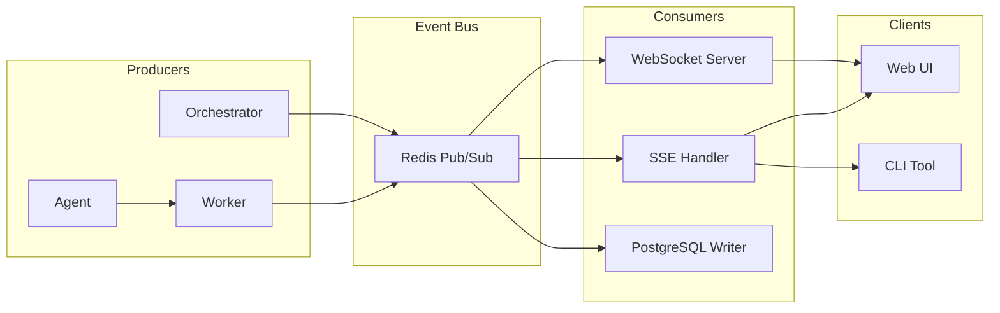
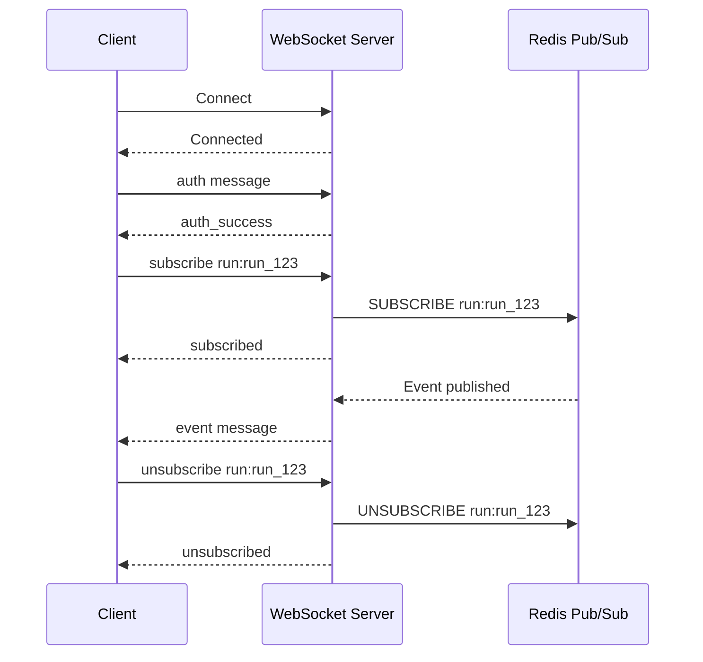
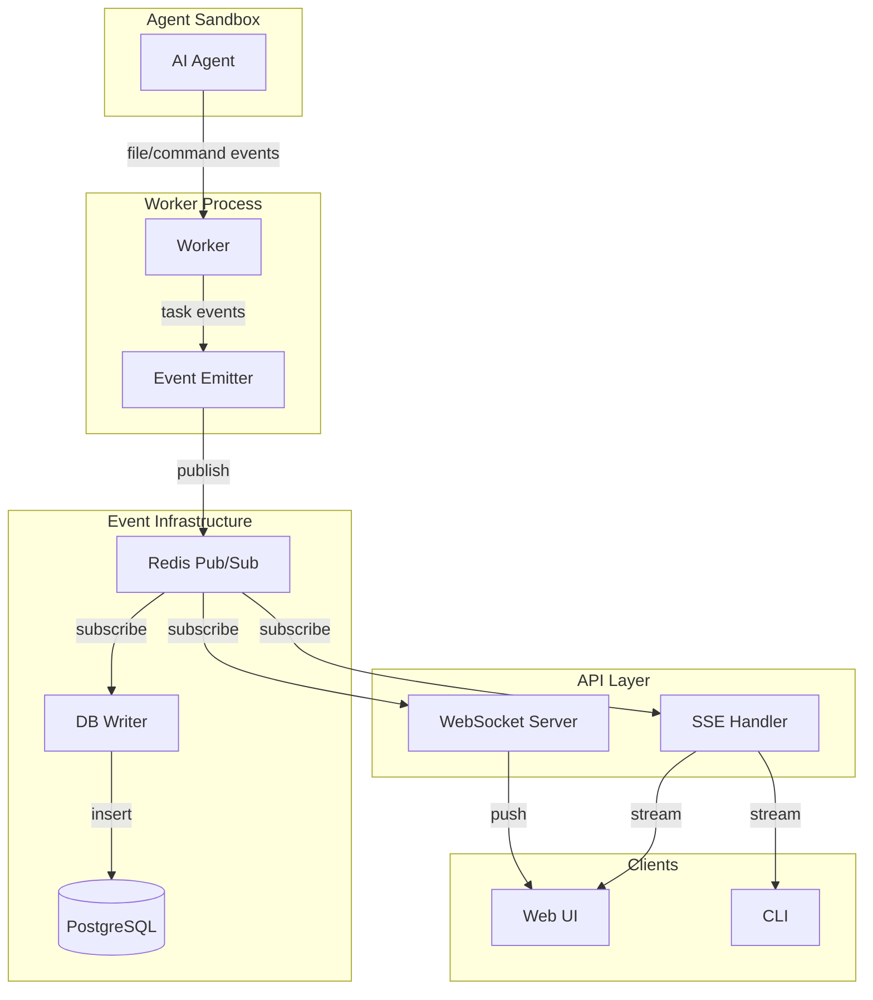

# Prazium Event System

## Overview

The event system provides real-time observability into build progress. Events are persisted to PostgreSQL for audit trails and streamed to clients via WebSocket or Server-Sent Events (SSE).

## Event Architecture



---

## Event Types

### Spec Events

| Event Type | Description | Producer |
|------------|-------------|----------|
| `SPEC_QUESTIONS_GENERATED` | Clarifying questions ready | Orchestrator |
| `SPEC_ANSWERS_RECEIVED` | User submitted answers | Orchestrator |
| `SPEC_CREATED` | Spec documents generated | Orchestrator |
| `SPEC_APPROVED` | User approved spec | Orchestrator |
| `SPEC_REJECTED` | User requested regeneration | Orchestrator |

### Run Events

| Event Type | Description | Producer |
|------------|-------------|----------|
| `RUN_CREATED` | Build run initialized | Orchestrator |
| `RUN_STARTED` | Build execution began | Orchestrator |
| `RUN_DECOMPOSING` | Task decomposition in progress | Orchestrator |
| `RUN_EXECUTING` | Tasks being executed | Orchestrator |
| `RUN_INTEGRATING` | Branches being merged | Orchestrator |
| `RUN_VERIFYING` | Verification in progress | Orchestrator |
| `RUN_SUCCEEDED` | Build completed successfully | Orchestrator |
| `RUN_FAILED` | Build failed | Orchestrator |
| `RUN_CANCELLED` | Build cancelled by user | Orchestrator |

### Task Events

| Event Type | Description | Producer |
|------------|-------------|----------|
| `TASK_QUEUED` | Task added to job queue | Orchestrator |
| `TASK_STARTED` | Worker began task execution | Worker |
| `TASK_PROGRESS` | Task progress update | Worker |
| `TASK_SUCCEEDED` | Task completed successfully | Worker |
| `TASK_FAILED` | Task execution failed | Worker |
| `TASK_RETRYING` | Task being retried | Worker |

### File Events

| Event Type | Description | Producer |
|------------|-------------|----------|
| `FILE_CREATED` | New file written | Agent |
| `FILE_MODIFIED` | Existing file changed | Agent |
| `FILE_DELETED` | File removed | Agent |
| `FILE_RENAMED` | File moved/renamed | Agent |

### Command Events

| Event Type | Description | Producer |
|------------|-------------|----------|
| `COMMAND_STARTED` | Shell command began | Agent |
| `COMMAND_OUTPUT` | Command stdout/stderr chunk | Agent |
| `COMMAND_SUCCEEDED` | Command completed with exit 0 | Agent |
| `COMMAND_FAILED` | Command failed | Agent |

### Git Events

| Event Type | Description | Producer |
|------------|-------------|----------|
| `GIT_COMMIT` | Changes committed | Worker |
| `GIT_MERGE_STARTED` | Branch merge began | Orchestrator |
| `GIT_MERGE_SUCCEEDED` | Branch merged successfully | Orchestrator |
| `GIT_MERGE_CONFLICT` | Merge conflict detected | Orchestrator |
| `GIT_TAG_CREATED` | Release tag created | Orchestrator |

### Verification Events

| Event Type | Description | Producer |
|------------|-------------|----------|
| `VERIFY_STARTED` | Verification began | Orchestrator |
| `VERIFY_LINT_STARTED` | Lint check started | Worker |
| `VERIFY_LINT_PASSED` | Lint check passed | Worker |
| `VERIFY_LINT_FAILED` | Lint check failed | Worker |
| `VERIFY_TEST_STARTED` | Test suite started | Worker |
| `VERIFY_TEST_PASSED` | Tests passed | Worker |
| `VERIFY_TEST_FAILED` | Tests failed | Worker |
| `VERIFY_BUILD_STARTED` | Build started | Worker |
| `VERIFY_BUILD_PASSED` | Build succeeded | Worker |
| `VERIFY_BUILD_FAILED` | Build failed | Worker |
| `VERIFY_ACCEPTANCE_STARTED` | Acceptance checks started | Worker |
| `VERIFY_ACCEPTANCE_PASSED` | Acceptance checks passed | Worker |
| `VERIFY_ACCEPTANCE_FAILED` | Acceptance checks failed | Worker |
| `VERIFY_COMPLETED` | All verification done | Orchestrator |

### Deployment Events

| Event Type | Description | Producer |
|------------|-------------|----------|
| `DEPLOY_STARTED` | Deployment initiated | Orchestrator |
| `DEPLOY_BUILDING_IMAGE` | Docker image building | Worker |
| `DEPLOY_PUSHING_IMAGE` | Image being pushed | Worker |
| `DEPLOY_PROVISIONING` | Infrastructure provisioning | Orchestrator |
| `DEPLOY_SUCCEEDED` | Deployment live | Orchestrator |
| `DEPLOY_FAILED` | Deployment failed | Orchestrator |

### Export Events

| Event Type | Description | Producer |
|------------|-------------|----------|
| `EXPORT_STARTED` | Export generation began | Orchestrator |
| `EXPORT_SUCCEEDED` | Export ready for download | Orchestrator |
| `EXPORT_FAILED` | Export generation failed | Orchestrator |

---

## Event Payloads

### Base Event Structure

```typescript
interface BaseEvent {
  id: string;           // UUID
  runId: string;        // UUID
  taskId?: string;      // UUID, optional
  eventType: string;
  payload: object;
  createdAt: string;    // ISO 8601
}
```

### Spec Events

#### SPEC_QUESTIONS_GENERATED

```json
{
  "eventType": "SPEC_QUESTIONS_GENERATED",
  "payload": {
    "questionCount": 5,
    "questions": [
      {
        "id": "q1",
        "question": "What authentication method?",
        "type": "single_choice",
        "options": ["Email/Password", "OAuth", "Magic Link"]
      }
    ]
  }
}
```

#### SPEC_CREATED

```json
{
  "eventType": "SPEC_CREATED",
  "payload": {
    "documents": ["SPEC.md", "ACCEPTANCE.md", "ROUTES.md", "DATA.md"],
    "taskCount": 6,
    "specVersion": 1
  }
}
```

#### SPEC_APPROVED

```json
{
  "eventType": "SPEC_APPROVED",
  "payload": {
    "approvedBy": "user_abc123",
    "specVersion": 1
  }
}
```

### Run Events

#### RUN_STARTED

```json
{
  "eventType": "RUN_STARTED",
  "payload": {
    "runNumber": 1,
    "trigger": "manual",
    "taskCount": 6
  }
}
```

#### RUN_SUCCEEDED

```json
{
  "eventType": "RUN_SUCCEEDED",
  "payload": {
    "runNumber": 1,
    "duration": 845,
    "tasksSucceeded": 6,
    "tasksFailed": 0,
    "releaseTag": "release/run-1"
  }
}
```

#### RUN_FAILED

```json
{
  "eventType": "RUN_FAILED",
  "payload": {
    "runNumber": 1,
    "duration": 423,
    "tasksSucceeded": 4,
    "tasksFailed": 2,
    "failedTasks": ["task-005", "task-006"],
    "error": "Verification failed: lint errors"
  }
}
```

### Task Events

#### TASK_STARTED

```json
{
  "eventType": "TASK_STARTED",
  "taskId": "task_001",
  "payload": {
    "slug": "ui-shell",
    "description": "Create Next.js app shell",
    "sequence": 1,
    "workerId": "worker-1"
  }
}
```

#### TASK_PROGRESS

```json
{
  "eventType": "TASK_PROGRESS",
  "taskId": "task_001",
  "payload": {
    "slug": "ui-shell",
    "phase": "generating",
    "message": "Creating layout component",
    "filesCreated": 2,
    "filesModified": 0
  }
}
```

#### TASK_SUCCEEDED

```json
{
  "eventType": "TASK_SUCCEEDED",
  "taskId": "task_001",
  "payload": {
    "slug": "ui-shell",
    "duration": 45,
    "filesCreated": ["src/app/layout.tsx", "src/app/page.tsx"],
    "filesModified": ["package.json"],
    "commitSha": "abc123def456"
  }
}
```

#### TASK_FAILED

```json
{
  "eventType": "TASK_FAILED",
  "taskId": "task_001",
  "payload": {
    "slug": "ui-shell",
    "duration": 30,
    "error": "Agent exceeded path scope",
    "errorCode": "PATH_SCOPE_VIOLATION",
    "attemptNumber": 1,
    "maxAttempts": 3
  }
}
```

### File Events

#### FILE_CREATED

```json
{
  "eventType": "FILE_CREATED",
  "taskId": "task_001",
  "payload": {
    "path": "src/app/layout.tsx",
    "size": 1234,
    "language": "typescript"
  }
}
```

#### FILE_MODIFIED

```json
{
  "eventType": "FILE_MODIFIED",
  "taskId": "task_001",
  "payload": {
    "path": "package.json",
    "size": 2345,
    "linesAdded": 5,
    "linesRemoved": 0
  }
}
```

### Command Events

#### COMMAND_STARTED

```json
{
  "eventType": "COMMAND_STARTED",
  "taskId": "task_001",
  "payload": {
    "command": "pnpm install",
    "cwd": "/workspace"
  }
}
```

#### COMMAND_OUTPUT

```json
{
  "eventType": "COMMAND_OUTPUT",
  "taskId": "task_001",
  "payload": {
    "stream": "stdout",
    "chunk": "Packages: +150\n",
    "timestamp": "2024-01-15T11:32:15.123Z"
  }
}
```

#### COMMAND_SUCCEEDED

```json
{
  "eventType": "COMMAND_SUCCEEDED",
  "taskId": "task_001",
  "payload": {
    "command": "pnpm install",
    "exitCode": 0,
    "duration": 12500
  }
}
```

### Git Events

#### GIT_COMMIT

```json
{
  "eventType": "GIT_COMMIT",
  "taskId": "task_001",
  "payload": {
    "sha": "abc123def456",
    "branch": "feat/task-001-ui-shell",
    "message": "feat: create app shell layout",
    "filesChanged": 3
  }
}
```

#### GIT_MERGE_SUCCEEDED

```json
{
  "eventType": "GIT_MERGE_SUCCEEDED",
  "payload": {
    "sourceBranch": "feat/task-001-ui-shell",
    "targetBranch": "main",
    "mergeCommit": "xyz789abc123"
  }
}
```

#### GIT_MERGE_CONFLICT

```json
{
  "eventType": "GIT_MERGE_CONFLICT",
  "payload": {
    "sourceBranch": "feat/task-003-api",
    "targetBranch": "main",
    "conflictingFiles": ["src/lib/api.ts"]
  }
}
```

### Verification Events

#### VERIFY_LINT_PASSED

```json
{
  "eventType": "VERIFY_LINT_PASSED",
  "payload": {
    "duration": 5200,
    "warnings": 3,
    "errors": 0
  }
}
```

#### VERIFY_TEST_PASSED

```json
{
  "eventType": "VERIFY_TEST_PASSED",
  "payload": {
    "duration": 15000,
    "total": 25,
    "passed": 25,
    "failed": 0,
    "skipped": 0,
    "coverage": 85.5
  }
}
```

#### VERIFY_BUILD_FAILED

```json
{
  "eventType": "VERIFY_BUILD_FAILED",
  "payload": {
    "duration": 8000,
    "error": "Type error in src/app/page.tsx",
    "output": "..."
  }
}
```

### Deployment Events

#### DEPLOY_SUCCEEDED

```json
{
  "eventType": "DEPLOY_SUCCEEDED",
  "payload": {
    "provider": "railway",
    "url": "https://my-app-preview.up.railway.app",
    "duration": 120000
  }
}
```

### Export Events

#### EXPORT_SUCCEEDED

```json
{
  "eventType": "EXPORT_SUCCEEDED",
  "payload": {
    "format": "zip",
    "sizeBytes": 5242880,
    "downloadUrl": "/exports/exp_123/download",
    "expiresAt": "2024-01-22T11:30:00Z"
  }
}
```

---

## Event Delivery

### Server-Sent Events (SSE)

**Endpoint**: `GET /projects/:projectId/runs/:runId/events/stream`

**Connection**:
```javascript
const eventSource = new EventSource(
  '/api/v1/projects/proj_123/runs/run_456/events/stream',
  { withCredentials: true }
);

eventSource.onmessage = (event) => {
  const data = JSON.parse(event.data);
  console.log(data.eventType, data.payload);
};

eventSource.onerror = (error) => {
  console.error('SSE error:', error);
};
```

**Message Format**:
```
event: TASK_STARTED
id: evt_abc123
data: {"eventType":"TASK_STARTED","taskId":"task_001","payload":{"slug":"ui-shell"}}

event: FILE_CREATED
id: evt_abc124
data: {"eventType":"FILE_CREATED","taskId":"task_001","payload":{"path":"src/app/layout.tsx"}}
```

**Reconnection**:
- Client sends `Last-Event-ID` header on reconnect
- Server replays events after that ID

---

### WebSocket

**Endpoint**: `wss://api.prazium.com/v1/ws`

**Protocol**:



**Message Types**:

#### Client → Server

```typescript
// Authentication
{
  "type": "auth",
  "token": "pzm_xxxxxxxxxxxx"
}

// Subscribe to channel
{
  "type": "subscribe",
  "channel": "run:run_123"
}

// Unsubscribe from channel
{
  "type": "unsubscribe",
  "channel": "run:run_123"
}

// Ping (keepalive)
{
  "type": "ping"
}
```

#### Server → Client

```typescript
// Authentication success
{
  "type": "auth_success",
  "userId": "user_abc123"
}

// Authentication failure
{
  "type": "auth_error",
  "error": "Invalid token"
}

// Subscription confirmed
{
  "type": "subscribed",
  "channel": "run:run_123"
}

// Event delivery
{
  "type": "event",
  "channel": "run:run_123",
  "data": {
    "id": "evt_abc123",
    "eventType": "TASK_STARTED",
    "taskId": "task_001",
    "payload": { ... },
    "createdAt": "2024-01-15T11:31:00Z"
  }
}

// Pong (keepalive response)
{
  "type": "pong"
}

// Error
{
  "type": "error",
  "error": "Channel not found"
}
```

**Channels**:
| Channel Pattern | Description |
|-----------------|-------------|
| `run:<runId>` | All events for a run |
| `task:<taskId>` | Events for specific task |
| `project:<projectId>` | All events for project |

---

## Event Persistence

### PostgreSQL Storage

Events are written to the `events` table asynchronously via a dedicated writer process.

```sql
INSERT INTO events (id, run_id, task_id, event_type, payload, created_at)
VALUES ($1, $2, $3, $4, $5, $6);
```

### Retention Policy

| Environment | Retention |
|-------------|-----------|
| Self-hosted | Configurable (default: 30 days) |
| Hosted Free | 7 days |
| Hosted Pro | 90 days |
| Hosted Enterprise | 1 year |

### Cleanup Job

```sql
DELETE FROM events
WHERE created_at < NOW() - INTERVAL '30 days';
```

---

## Redis Pub/Sub

### Channel Naming

```
prazium:events:run:<runId>
prazium:events:task:<taskId>
prazium:events:project:<projectId>
```

### Message Format

```json
{
  "id": "evt_abc123",
  "runId": "run_xyz789",
  "taskId": "task_001",
  "eventType": "TASK_STARTED",
  "payload": { ... },
  "createdAt": "2024-01-15T11:31:00Z"
}
```

### Publishing

```typescript
await redis.publish(
  `prazium:events:run:${runId}`,
  JSON.stringify(event)
);
```

---

## Event Flow Diagram



---

## Client Implementation

### React Hook Example

```typescript
import { useEffect, useState, useCallback } from 'react';

interface Event {
  id: string;
  eventType: string;
  taskId?: string;
  payload: any;
  createdAt: string;
}

export function useRunEvents(runId: string) {
  const [events, setEvents] = useState<Event[]>([]);
  const [connected, setConnected] = useState(false);

  useEffect(() => {
    const eventSource = new EventSource(
      `/api/v1/runs/${runId}/events/stream`
    );

    eventSource.onopen = () => setConnected(true);
    
    eventSource.onmessage = (e) => {
      const event = JSON.parse(e.data);
      setEvents(prev => [...prev, event]);
    };

    eventSource.onerror = () => {
      setConnected(false);
    };

    return () => eventSource.close();
  }, [runId]);

  return { events, connected };
}
```

### Event Aggregation

```typescript
interface RunProgress {
  status: string;
  totalTasks: number;
  completedTasks: number;
  runningTasks: number;
  failedTasks: number;
  currentPhase: string;
}

function aggregateProgress(events: Event[]): RunProgress {
  const taskStatuses = new Map<string, string>();
  let status = 'pending';
  let currentPhase = 'initializing';

  for (const event of events) {
    switch (event.eventType) {
      case 'RUN_STARTED':
        status = 'running';
        break;
      case 'RUN_DECOMPOSING':
        currentPhase = 'decomposing';
        break;
      case 'RUN_EXECUTING':
        currentPhase = 'executing';
        break;
      case 'TASK_STARTED':
        taskStatuses.set(event.taskId!, 'running');
        break;
      case 'TASK_SUCCEEDED':
        taskStatuses.set(event.taskId!, 'succeeded');
        break;
      case 'TASK_FAILED':
        taskStatuses.set(event.taskId!, 'failed');
        break;
      case 'RUN_SUCCEEDED':
        status = 'succeeded';
        currentPhase = 'complete';
        break;
      case 'RUN_FAILED':
        status = 'failed';
        currentPhase = 'complete';
        break;
    }
  }

  const statuses = Array.from(taskStatuses.values());
  
  return {
    status,
    totalTasks: taskStatuses.size,
    completedTasks: statuses.filter(s => s === 'succeeded').length,
    runningTasks: statuses.filter(s => s === 'running').length,
    failedTasks: statuses.filter(s => s === 'failed').length,
    currentPhase,
  };
}
```

---

## Related Documentation

- [Architecture Overview](./ARCHITECTURE.md)
- [Database Schema](./DATABASE.md)
- [API Specification](./API.md)
- [UI Specification](./UI-SPEC.md)
