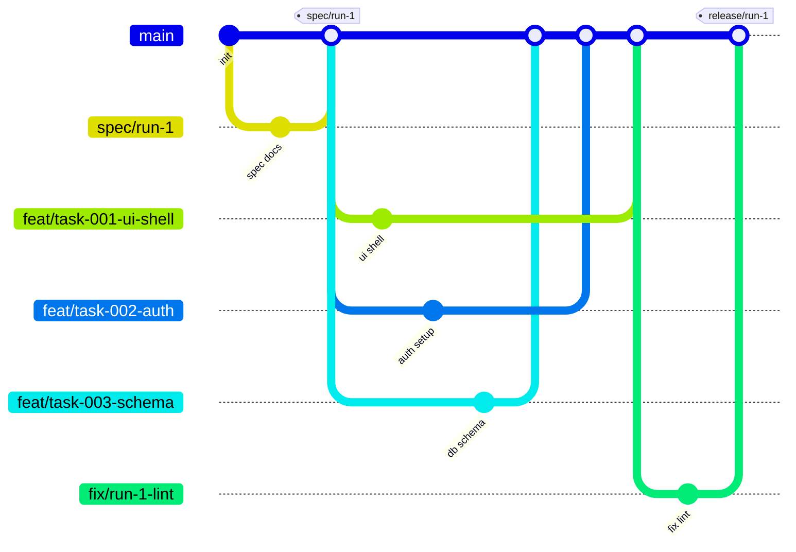
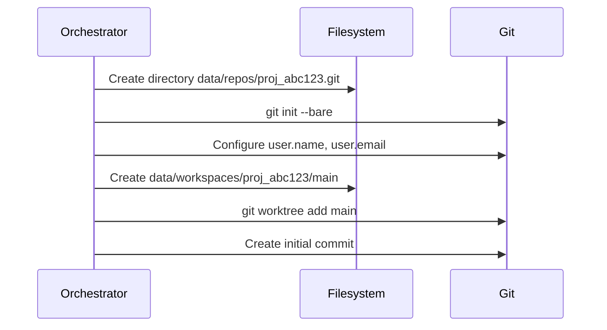
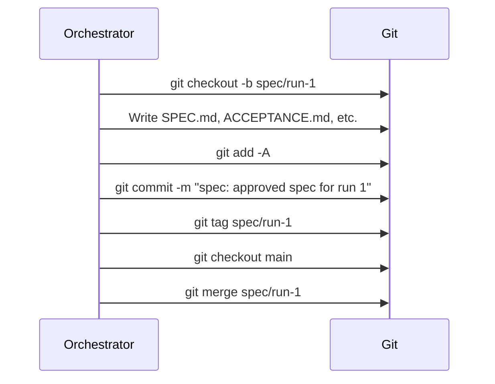
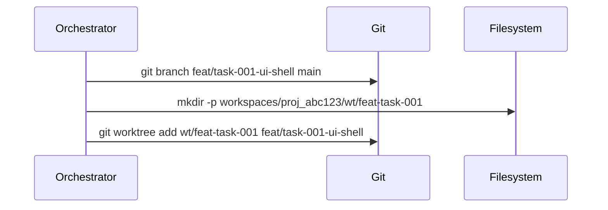
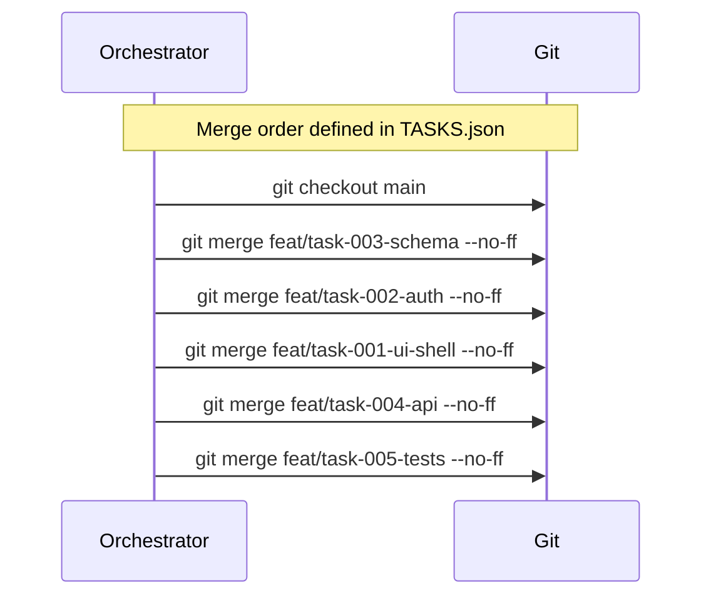
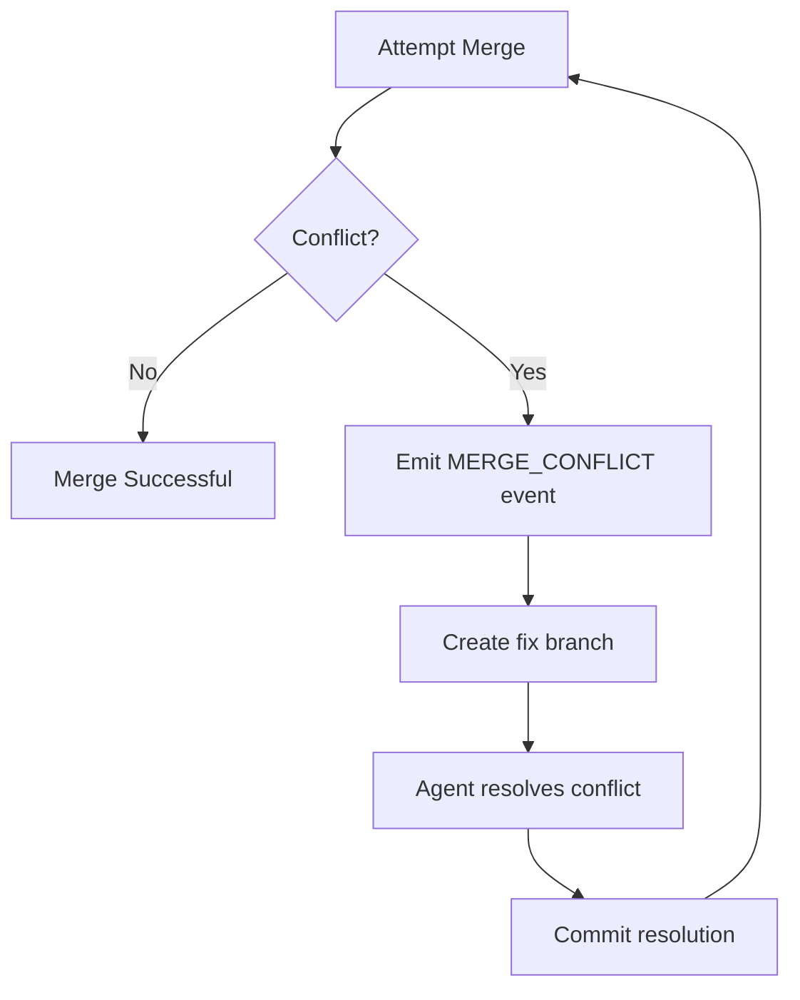

# Prazium Internal Git Model

## Overview

Prazium uses Git as an internal implementation detail for version control, branching, and reproducible builds. Users never interact with Git directly—it's abstracted behind the Prazium UI and API.

## Design Principles

1. **One repository per product** - Complete isolation between projects
2. **Bare repositories** - No working directory in the repo itself
3. **Worktrees for parallelism** - Each task gets its own worktree
4. **Deterministic merging** - Branches merged in defined order
5. **Immutable releases** - Tagged releases are never modified
6. **User abstraction** - No Git concepts exposed to users

---

## Filesystem Layout

```
data/
├── repos/
│   ├── proj_abc123.git/           # Bare repository
│   │   ├── HEAD
│   │   ├── config
│   │   ├── objects/
│   │   ├── refs/
│   │   │   ├── heads/
│   │   │   │   ├── main
│   │   │   │   ├── spec/run-1
│   │   │   │   ├── feat/task-001-ui-shell
│   │   │   │   └── feat/task-002-auth
│   │   │   └── tags/
│   │   │       ├── spec/run-1
│   │   │       └── release/run-1
│   │   └── hooks/
│   └── proj_def456.git/
│
└── workspaces/
    ├── proj_abc123/
    │   ├── main/                   # Main branch checkout
    │   │   ├── .git                # Worktree link
    │   │   ├── src/
    │   │   ├── package.json
    │   │   └── ...
    │   └── wt/                     # Task worktrees
    │       ├── feat-task-001/
    │       │   ├── .git
    │       │   └── ...
    │       └── feat-task-002/
    │           ├── .git
    │           └── ...
    └── proj_def456/
        └── ...
```

---

## Branch Strategy



### Branch Types

| Pattern | Purpose | Lifecycle |
|---------|---------|-----------|
| `main` | Last verified green build | Permanent |
| `spec/<runId>` | Approved spec snapshot | Kept until project archived |
| `feat/<taskId>-<slug>` | Agent task work | Deleted after merge |
| `fix/<runId>-<slug>` | Verifier fixes | Deleted after merge |
| `release/<runId>` | Immutable release | Permanent |

### Branch Naming Convention

```
feat/task-001-ui-shell
│    │        └── Human-readable slug
│    └── Task ID (zero-padded)
└── Branch type

fix/run-1-lint-errors
│   │     └── Description
│   └── Run ID
└── Branch type
```

---

## Tag Strategy

### Spec Tags

Created when user approves a spec:

```
spec/run-1
spec/run-2
```

**Tag Message**:
```
Approved spec for run 1

Documents:
- SPEC.md
- ACCEPTANCE.md
- ROUTES.md
- DATA.md

Approved by: user_abc123
Approved at: 2024-01-15T11:00:00Z
```

### Release Tags

Created when a build passes verification:

```
release/run-1
release/run-2
```

**Tag Message**:
```
Release for run 1

Build Status: PASSED
Verification:
- Lint: PASSED
- Test: PASSED (25/25, 85% coverage)
- Build: PASSED

Tasks completed: 6/6
Duration: 845 seconds
```

---

## Repository Lifecycle

### 1. Repository Initialization



**Initial Commit Contents**:
```
.gitignore
.env.example
README.md
```

### 2. Spec Commit

When spec is approved:



### 3. Task Worktree Creation

For each parallel task:



### 4. Task Commit

Agent commits changes:

```bash
cd /data/workspaces/proj_abc123/wt/feat-task-001
git add -A
git commit -m "feat(ui-shell): create app layout and home page"
```

**Commit Message Format**:
```
<type>(<scope>): <description>

<body>

Task: task-001
Run: run-1
Agent: claude-3-opus
```

### 5. Integration (Merge)

Branches merged in deterministic order:



### 6. Release Tag

After verification passes:

```bash
git tag -a release/run-1 -m "Release for run 1"
```

### 7. Cleanup

After successful merge:

```bash
# Remove worktrees
git worktree remove wt/feat-task-001
git worktree remove wt/feat-task-002

# Delete feature branches
git branch -d feat/task-001-ui-shell
git branch -d feat/task-002-auth
```

---

## Merge Strategy

### Merge Order

Tasks are merged in a specific order to minimize conflicts:

1. **Schema & Contracts** - Database schema, TypeScript types, API contracts
2. **Authentication** - Auth setup, middleware
3. **API Routes** - Backend endpoints
4. **UI Components** - Frontend components
5. **Pages** - Page-level components
6. **Tests** - Test files

### Conflict Resolution



**Conflict Handling**:
1. Detect conflict during merge
2. Emit `GIT_MERGE_CONFLICT` event
3. Create `fix/<runId>-conflict-<n>` branch
4. Agent analyzes conflict markers
5. Agent resolves and commits
6. Retry merge

---

## Git Operations

### Using isomorphic-git (Pure JS)

```typescript
import * as git from 'isomorphic-git';
import fs from 'fs';

// Initialize bare repo
await git.init({
  fs,
  dir: '/data/repos/proj_abc123.git',
  bare: true,
});

// Clone to worktree
await git.clone({
  fs,
  dir: '/data/workspaces/proj_abc123/main',
  url: '/data/repos/proj_abc123.git',
  ref: 'main',
});

// Commit changes
await git.add({ fs, dir: worktreePath, filepath: '.' });
await git.commit({
  fs,
  dir: worktreePath,
  message: 'feat(ui-shell): create layout',
  author: {
    name: 'Prazium Agent',
    email: 'agent@prazium.com',
  },
});
```

### Using libgit2 (Native Performance)

For operations requiring better performance:

```typescript
import { Repository, Signature, Merge } from 'nodegit';

// Open repository
const repo = await Repository.openBare('/data/repos/proj_abc123.git');

// Create branch
const commit = await repo.getHeadCommit();
await repo.createBranch('feat/task-001-ui-shell', commit, false);

// Merge branches
const theirCommit = await repo.getBranchCommit('feat/task-001-ui-shell');
await Merge.merge(repo, theirCommit, null, {
  fileFavor: Merge.FILE_FAVOR.NORMAL,
});
```

---

## Worktree Management

### Creating Worktrees

```typescript
interface WorktreeConfig {
  repoPath: string;
  worktreePath: string;
  branchName: string;
  baseBranch: string;
}

async function createWorktree(config: WorktreeConfig): Promise<void> {
  const { repoPath, worktreePath, branchName, baseBranch } = config;
  
  // Create branch from base
  await exec(`git -C ${repoPath} branch ${branchName} ${baseBranch}`);
  
  // Create worktree
  await exec(`git -C ${repoPath} worktree add ${worktreePath} ${branchName}`);
}
```

### Worktree Isolation

Each worktree is completely isolated:

```
workspaces/proj_abc123/
├── main/                    # Main branch
│   └── .git                 # Points to bare repo
├── wt/
│   ├── feat-task-001/       # Task 1 worktree
│   │   └── .git             # Independent working state
│   └── feat-task-002/       # Task 2 worktree
│       └── .git             # Independent working state
```

### Cleanup

```typescript
async function cleanupWorktree(
  repoPath: string,
  worktreePath: string,
  branchName: string
): Promise<void> {
  // Remove worktree
  await exec(`git -C ${repoPath} worktree remove ${worktreePath} --force`);
  
  // Delete branch
  await exec(`git -C ${repoPath} branch -D ${branchName}`);
  
  // Prune worktree references
  await exec(`git -C ${repoPath} worktree prune`);
}
```

---

## Path Scoping

Agents are restricted to specific paths to prevent conflicts:

```typescript
interface TaskDefinition {
  id: string;
  slug: string;
  pathScope: string[];  // Glob patterns
}

// Example task scopes
const tasks: TaskDefinition[] = [
  {
    id: 'task-001',
    slug: 'ui-shell',
    pathScope: ['src/app/layout.tsx', 'src/app/page.tsx', 'src/components/layout/**'],
  },
  {
    id: 'task-002',
    slug: 'auth',
    pathScope: ['src/lib/auth/**', 'src/app/api/auth/**', 'src/middleware.ts'],
  },
  {
    id: 'task-003',
    slug: 'schema',
    pathScope: ['supabase/**', 'src/lib/db/**', 'src/types/**'],
  },
];
```

### Scope Enforcement

```typescript
import { minimatch } from 'minimatch';

function isPathAllowed(path: string, pathScope: string[]): boolean {
  return pathScope.some(pattern => minimatch(path, pattern));
}

// Pre-commit hook validates changes
async function validateCommit(
  worktreePath: string,
  pathScope: string[]
): Promise<void> {
  const stagedFiles = await getStagedFiles(worktreePath);
  
  for (const file of stagedFiles) {
    if (!isPathAllowed(file, pathScope)) {
      throw new PathScopeViolationError(
        `File ${file} is outside task scope`
      );
    }
  }
}
```

---

## Reproducible Builds

### Rebuilding from Tag

```bash
# Checkout release tag
git checkout release/run-1

# Install dependencies
pnpm install --frozen-lockfile

# Build
pnpm build
```

### Determinism Guarantees

1. **Lockfile committed** - `pnpm-lock.yaml` always committed
2. **Exact versions** - No floating versions in package.json
3. **Merge order recorded** - TASKS.json defines merge sequence
4. **Tagged releases** - Every release is tagged and immutable

---

## Git Configuration

### Repository Config

```ini
[core]
    bare = true
    
[user]
    name = Prazium System
    email = system@prazium.com

[receive]
    denyCurrentBranch = updateInstead
```

### Worktree Config

```ini
[core]
    worktree = /data/workspaces/proj_abc123/main
    
[user]
    name = Prazium Agent
    email = agent@prazium.com
```

---

## Error Handling

### Common Errors

| Error | Cause | Resolution |
|-------|-------|------------|
| `WORKTREE_EXISTS` | Worktree already exists | Remove and recreate |
| `BRANCH_EXISTS` | Branch already exists | Delete or use different name |
| `MERGE_CONFLICT` | Conflicting changes | Agent resolution |
| `DIRTY_WORKTREE` | Uncommitted changes | Stash or discard |
| `DETACHED_HEAD` | Not on a branch | Checkout branch |

### Recovery Procedures

```typescript
async function recoverWorktree(
  repoPath: string,
  worktreePath: string
): Promise<void> {
  // Force remove corrupted worktree
  await exec(`rm -rf ${worktreePath}`);
  
  // Prune worktree references
  await exec(`git -C ${repoPath} worktree prune`);
  
  // Recreate worktree
  await createWorktree({ ... });
}
```

---

## Related Documentation

- [Architecture Overview](./ARCHITECTURE.md)
- [SDLC Workflow](./SDLC.md)
- [Agent Execution](./AGENTS.md)
- [Security Model](./SECURITY.md)
