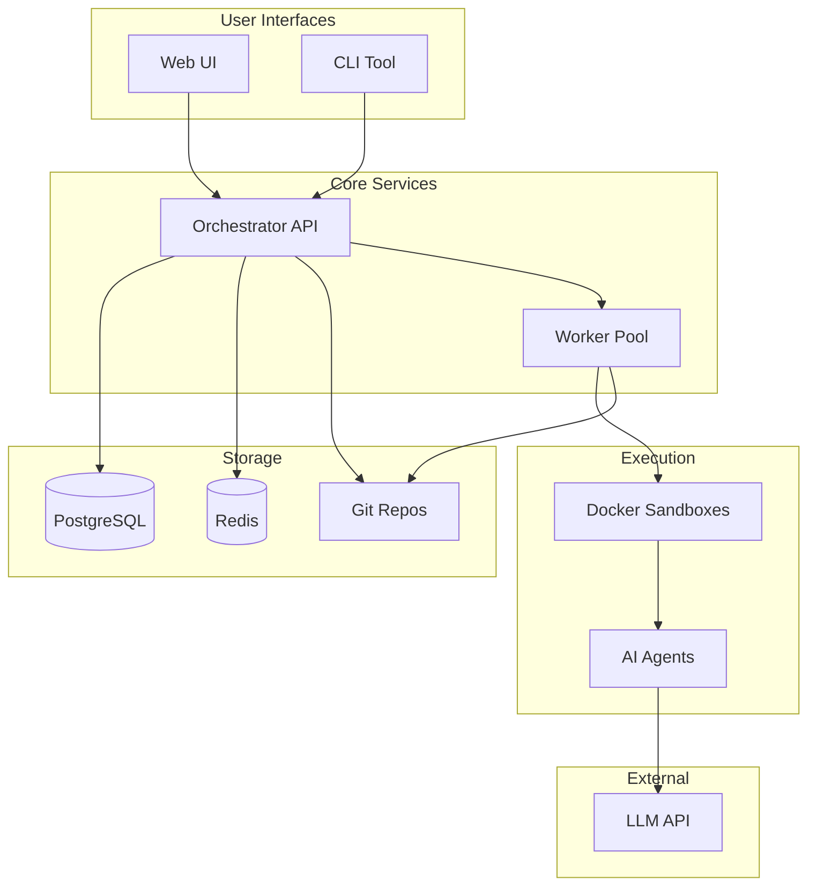
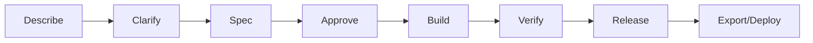

# Prazium Documentation

Welcome to the Prazium technical documentation. This documentation covers all aspects of the Prazium AI-powered application factory.

## Quick Links

| Document | Description |
|----------|-------------|
| [PRD](./PRD.md) | Product Requirements Document - the source of truth |
| [Architecture](./ARCHITECTURE.md) | System architecture and component overview |
| [Database](./DATABASE.md) | PostgreSQL schema and data model |
| [API](./API.md) | REST API specification |
| [Events](./EVENTS.md) | Real-time event system and WebSocket/SSE |
| [Git Model](./GIT-MODEL.md) | Internal Git repository structure |
| [SDLC](./SDLC.md) | Build pipeline and workflow |
| [Agents](./AGENTS.md) | AI agent execution model |
| [Security](./SECURITY.md) | Security model and sandbox isolation |
| [Deployment](./DEPLOYMENT.md) | Docker Compose and deployment guide |
| [UI Spec](./UI-SPEC.md) | Web UI components and design |
| [CLI](./CLI.md) | Command-line interface reference |

---

## System Overview



---

## SDLC Flow



---

## Getting Started

### For Users

1. **Create a project** - Describe what you want to build
2. **Answer questions** - Clarify requirements
3. **Review spec** - Approve the generated specification
4. **Watch build** - Monitor real-time progress
5. **Export** - Download your complete application

### For Developers

1. **Clone the repository**
   ```bash
   git clone https://github.com/prazium/prazium.git
   cd prazium
   ```

2. **Set up environment**
   ```bash
   cp .env.example .env
   # Edit .env with your configuration
   ```

3. **Start services**
   ```bash
   docker compose up -d
   ```

4. **Access the UI**
   ```
   http://localhost:3000
   ```

### For Self-Hosting

See the [Deployment Guide](./DEPLOYMENT.md) for complete instructions on:
- Docker Compose setup
- Production configuration
- SSL/TLS setup
- Backup and recovery

---

## Technology Stack

| Layer | Technology |
|-------|------------|
| Frontend | Next.js 15, React 19, Tailwind CSS |
| Backend | Node.js, Fastify, TypeScript |
| Database | PostgreSQL 16 |
| Queue | BullMQ, Redis |
| Version Control | Git (isomorphic-git, libgit2) |
| Containers | Docker |
| AI | OpenAI / Anthropic APIs |

---

## Key Concepts

### Projects
A project represents a single application being built. Each project has its own Git repository and build history.

### Runs
A run is a single build attempt. Each run goes through the SDLC phases: decompose → execute → integrate → verify → release.

### Tasks
Tasks are atomic units of work executed by AI agents. Tasks run in parallel when dependencies allow.

### Agents
AI agents execute tasks in isolated Docker sandboxes. They can read/write files and run commands within their scope.

### Events
Events provide real-time visibility into build progress. They're streamed via SSE or WebSocket.

---

## MVP Features

### Included in v1

- ✅ Product description intake
- ✅ Clarifying questions
- ✅ Spec generation and approval
- ✅ Parallel task execution
- ✅ Real-time build watching
- ✅ Verification gates (lint, test, build)
- ✅ Export bundles (zip, tarball)
- ✅ Docker sandbox isolation
- ✅ Internal Git repositories
- ✅ CLI tool

### Not in v1 (Future)

- ❌ Visual editor
- ❌ Plugin marketplace
- ❌ Multi-cloud deployment
- ❌ Fine-grained RBAC
- ❌ Persistent runtime hosting

---

## Architecture Decisions

| Decision | Rationale |
|----------|-----------|
| Internal Git | No dependency on GitHub; full control over repos |
| Bare repos + worktrees | Parallel task execution without conflicts |
| Docker sandboxes | Security isolation for untrusted code |
| PostgreSQL | Reliable, JSONB support, ecosystem |
| SSE for events | Simpler than WebSocket, auto-reconnect |
| Next.js | SSR, App Router, React 19 support |

---

## Contributing

See [CONTRIBUTING.md](../CONTRIBUTING.md) for guidelines on:
- Code style
- Pull request process
- Testing requirements
- Documentation standards

---

## License

Prazium is open source under the [MIT License](../LICENSE).

---

## Support

- **Documentation**: You're here!
- **Issues**: [GitHub Issues](https://github.com/prazium/prazium/issues)
- **Discussions**: [GitHub Discussions](https://github.com/prazium/prazium/discussions)
- **Security**: security@prazium.com
