# Prazium SDLC Workflow

## Overview

Prazium implements a deterministic Software Development Lifecycle (SDLC) that transforms a product description into a production-ready application through a series of well-defined stages.

## SDLC Phases

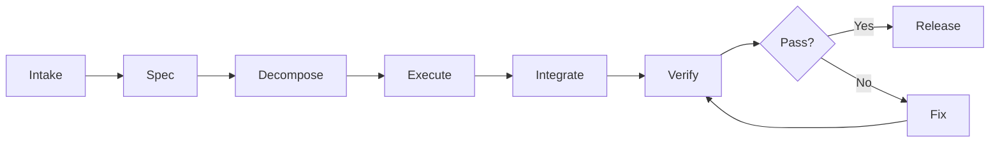

---

## State Machine

### Project States

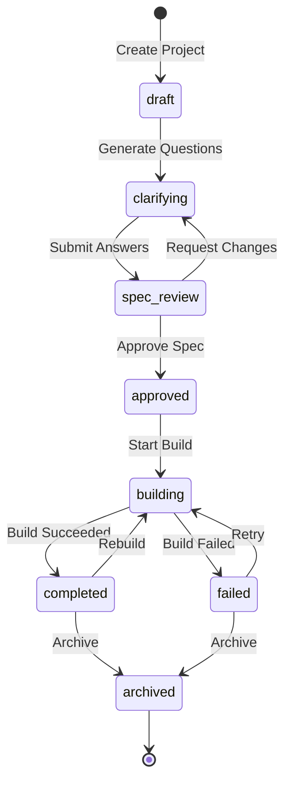

### Run States

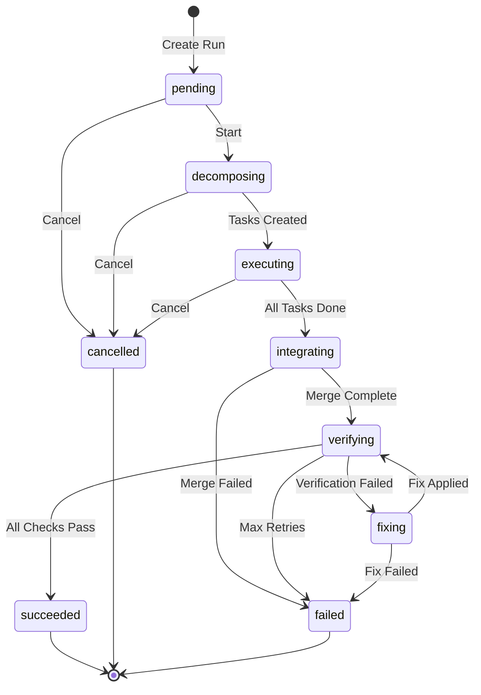

### Task States

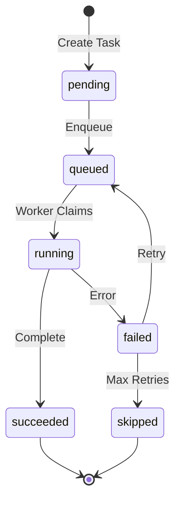

---

## Phase Details

### 1. Intake Phase

**Purpose**: Capture the user's product vision

**Inputs**:
- Product name
- Product description (free-form text)

**Process**:
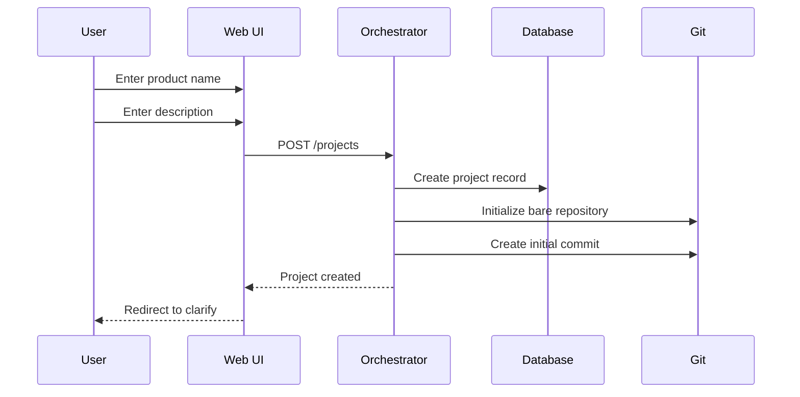

**Outputs**:
- Project record in database
- Initialized Git repository
- Project status: `draft`

---

### 2. Clarification Phase

**Purpose**: Gather additional context through targeted questions

**Inputs**:
- Product description
- Project context

**Process**:
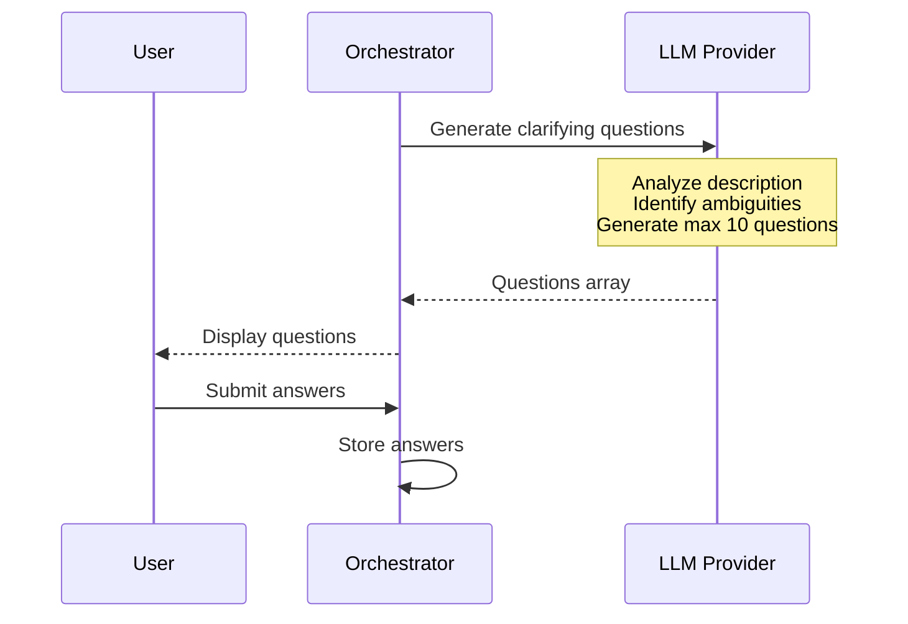

**Question Types**:
| Type | Description | Example |
|------|-------------|---------|
| `single_choice` | Select one option | Authentication method |
| `multi_choice` | Select multiple | Features to include |
| `boolean` | Yes/No | Real-time collaboration? |
| `text` | Free-form input | Custom requirements |

**Constraints**:
- Maximum 10 questions
- Questions must be actionable
- Avoid technical jargon

**Outputs**:
- Clarification answers stored
- Project status: `clarifying` → `spec_review`

---

### 3. Spec Generation Phase

**Purpose**: Generate comprehensive specification documents

**Inputs**:
- Product description
- Clarification answers

**Process**:
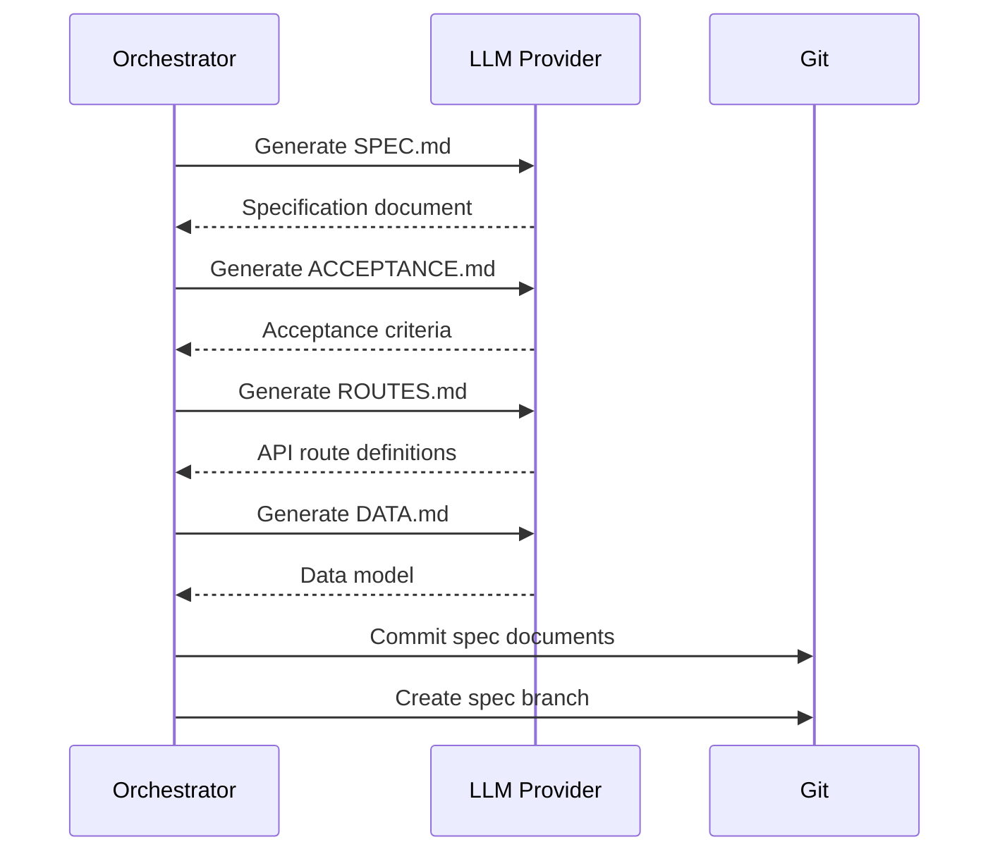

**Generated Documents**:

#### SPEC.md
```markdown
# Product Specification

## Overview
[Product summary]

## Features
### Feature 1: User Authentication
- Email/password login
- Password reset flow
- Session management

### Feature 2: Dashboard
- Overview metrics
- Recent activity
- Quick actions

## User Flows
1. Registration flow
2. Login flow
3. Main workflow

## Technical Requirements
- Performance targets
- Browser support
- Accessibility requirements
```

#### ACCEPTANCE.md
```markdown
# Acceptance Criteria

## Authentication
- [ ] User can register with email/password
- [ ] User can log in with valid credentials
- [ ] User sees error for invalid credentials
- [ ] User can reset password via email

## Dashboard
- [ ] Dashboard loads within 2 seconds
- [ ] Metrics display correctly
- [ ] Activity feed shows recent items
```

#### ROUTES.md
```markdown
# API Routes

## Authentication
| Method | Path | Description |
|--------|------|-------------|
| POST | /api/auth/register | Register new user |
| POST | /api/auth/login | User login |
| POST | /api/auth/logout | User logout |
| POST | /api/auth/reset-password | Request password reset |

## Dashboard
| Method | Path | Description |
|--------|------|-------------|
| GET | /api/dashboard/metrics | Get dashboard metrics |
| GET | /api/dashboard/activity | Get recent activity |
```

#### DATA.md
```markdown
# Data Model

## Users
| Column | Type | Constraints |
|--------|------|-------------|
| id | uuid | PK |
| email | varchar | unique, not null |
| password_hash | varchar | not null |
| created_at | timestamp | not null |

## Sessions
| Column | Type | Constraints |
|--------|------|-------------|
| id | uuid | PK |
| user_id | uuid | FK users.id |
| expires_at | timestamp | not null |
```

**User Review**:
- User reviews generated spec
- User can request regeneration with feedback
- User must explicitly approve before build

**Outputs**:
- Spec documents committed to `spec/<runId>` branch
- Spec tagged as `spec/<runId>`
- Project status: `spec_review` → `approved`

---

### 4. Task Decomposition Phase

**Purpose**: Break spec into parallelizable, atomic tasks

**Inputs**:
- Approved spec documents
- Default stack configuration

**Process**:
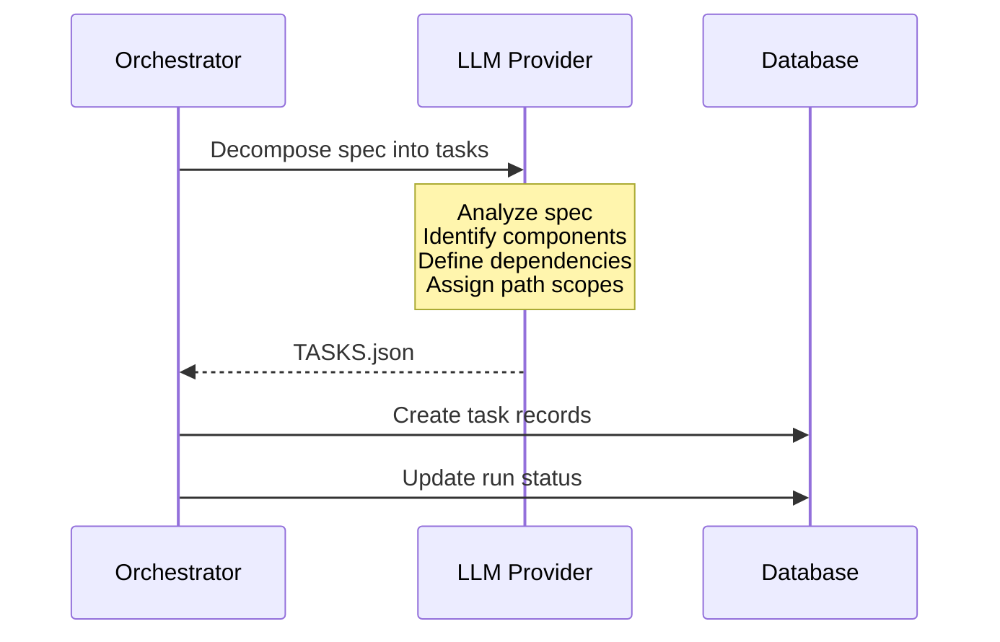

**Task Requirements**:
1. **Atomic** - Single, well-defined outcome
2. **Parallelizable** - Minimal dependencies
3. **Path-scoped** - Non-overlapping file paths
4. **Testable** - Clear success criteria

**TASKS.json Structure**:
```json
{
  "version": 1,
  "tasks": [
    {
      "id": "task-001",
      "slug": "project-setup",
      "description": "Initialize Next.js project with dependencies",
      "instructions": "Create Next.js 15 app with App Router...",
      "dependencies": [],
      "pathScope": ["package.json", "tsconfig.json", "next.config.js", "tailwind.config.js"],
      "sequence": 1,
      "expectedOutputs": ["package.json", "tsconfig.json"]
    },
    {
      "id": "task-002",
      "slug": "ui-shell",
      "description": "Create application shell and layout",
      "instructions": "Create root layout with navigation...",
      "dependencies": ["task-001"],
      "pathScope": ["src/app/layout.tsx", "src/app/page.tsx", "src/components/layout/**"],
      "sequence": 2,
      "expectedOutputs": ["src/app/layout.tsx"]
    },
    {
      "id": "task-003",
      "slug": "database-schema",
      "description": "Create Supabase schema and RLS policies",
      "instructions": "Create database migrations...",
      "dependencies": ["task-001"],
      "pathScope": ["supabase/**", "src/lib/db/**", "src/types/database.ts"],
      "sequence": 2,
      "expectedOutputs": ["supabase/migrations/*.sql"]
    },
    {
      "id": "task-004",
      "slug": "authentication",
      "description": "Implement Supabase authentication",
      "instructions": "Set up auth with Supabase...",
      "dependencies": ["task-002", "task-003"],
      "pathScope": ["src/lib/auth/**", "src/app/api/auth/**", "src/middleware.ts"],
      "sequence": 3,
      "expectedOutputs": ["src/lib/auth/client.ts"]
    },
    {
      "id": "task-005",
      "slug": "api-routes",
      "description": "Implement API route handlers",
      "instructions": "Create API routes per ROUTES.md...",
      "dependencies": ["task-003", "task-004"],
      "pathScope": ["src/app/api/**"],
      "sequence": 4,
      "expectedOutputs": ["src/app/api/*/route.ts"]
    },
    {
      "id": "task-006",
      "slug": "tests",
      "description": "Create test suite",
      "instructions": "Write tests for all components...",
      "dependencies": ["task-004", "task-005"],
      "pathScope": ["src/**/*.test.ts", "src/**/*.test.tsx", "vitest.config.ts"],
      "sequence": 5,
      "expectedOutputs": ["vitest.config.ts"]
    }
  ],
  "mergeOrder": [
    "task-001",
    "task-003",
    "task-002",
    "task-004",
    "task-005",
    "task-006"
  ]
}
```

**Outputs**:
- Task records in database
- Run status: `decomposing` → `executing`

---

### 5. Parallel Execution Phase

**Purpose**: Execute tasks concurrently using AI agents

**Inputs**:
- Task definitions
- Git worktrees
- Sandbox environments

**Process**:
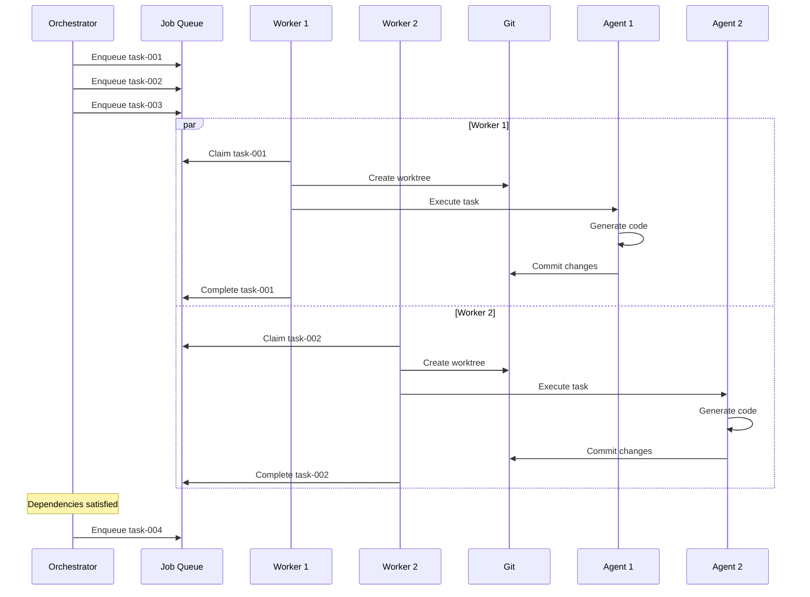

**Execution Rules**:
1. Tasks execute when all dependencies complete
2. Each task gets isolated worktree
3. Agents run in Docker sandboxes
4. Path scope enforced via pre-commit hooks
5. Maximum 3 retry attempts per task

**Outputs**:
- Code committed to feature branches
- Task status updates
- Events emitted for UI

---

### 6. Integration Phase

**Purpose**: Merge all task branches into main

**Inputs**:
- Completed task branches
- Merge order from TASKS.json

**Process**:
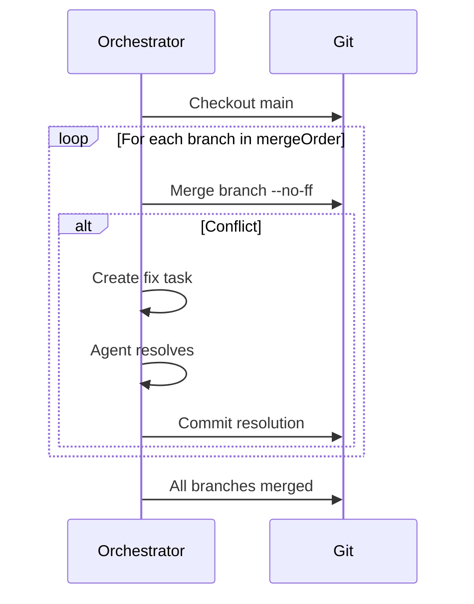

**Merge Strategy**:
- `--no-ff` to preserve branch history
- Deterministic order prevents race conditions
- Conflicts trigger automated resolution

**Outputs**:
- All changes on main branch
- Run status: `executing` → `integrating` → `verifying`

---

### 7. Verification Phase

**Purpose**: Validate the build meets quality standards

**Inputs**:
- Merged codebase on main
- Acceptance criteria

**Process**:
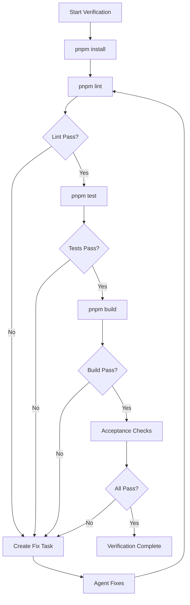

**Verification Steps**:

| Step | Command | Success Criteria |
|------|---------|------------------|
| Install | `pnpm install` | Exit code 0 |
| Lint | `pnpm lint` | No errors |
| Test | `pnpm test` | All tests pass |
| Build | `pnpm build` | Exit code 0 |
| Acceptance | Custom checks | All criteria met |

**Fix Loop**:
1. Identify failing check
2. Create `fix/<runId>-<issue>` branch
3. Agent analyzes error output
4. Agent applies fix
5. Commit and merge
6. Re-run verification
7. Maximum 3 fix attempts

**Outputs**:
- Verification results stored
- Run status: `verifying` → `succeeded` or `failed`

---

### 8. Release Phase

**Purpose**: Create immutable release artifact

**Inputs**:
- Verified codebase
- Run metadata

**Process**:
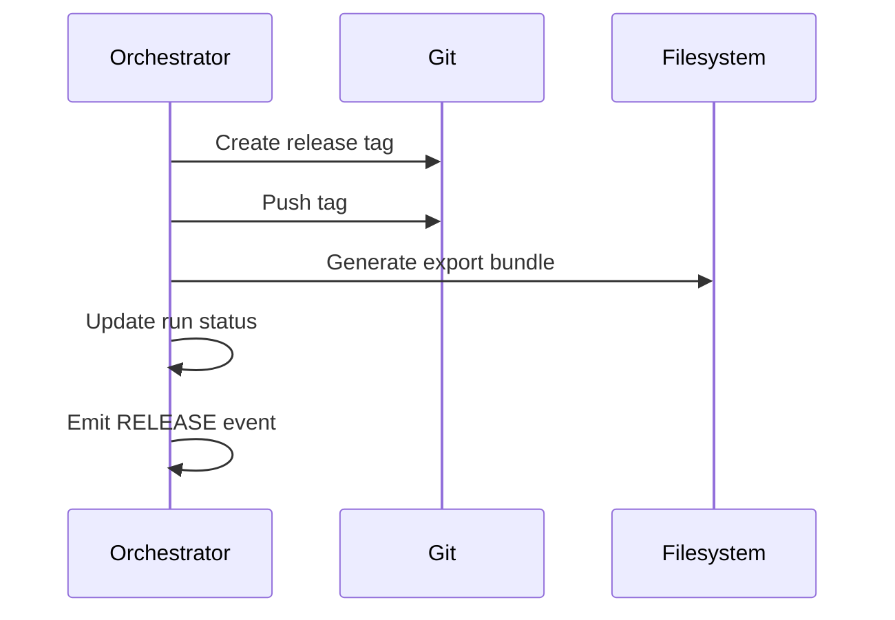

**Release Artifacts**:
- Git tag: `release/<runId>`
- Export bundle (zip/tarball)
- Build metadata

**Outputs**:
- Immutable release tag
- Downloadable export
- Project status: `completed`

---

## Timing Diagram

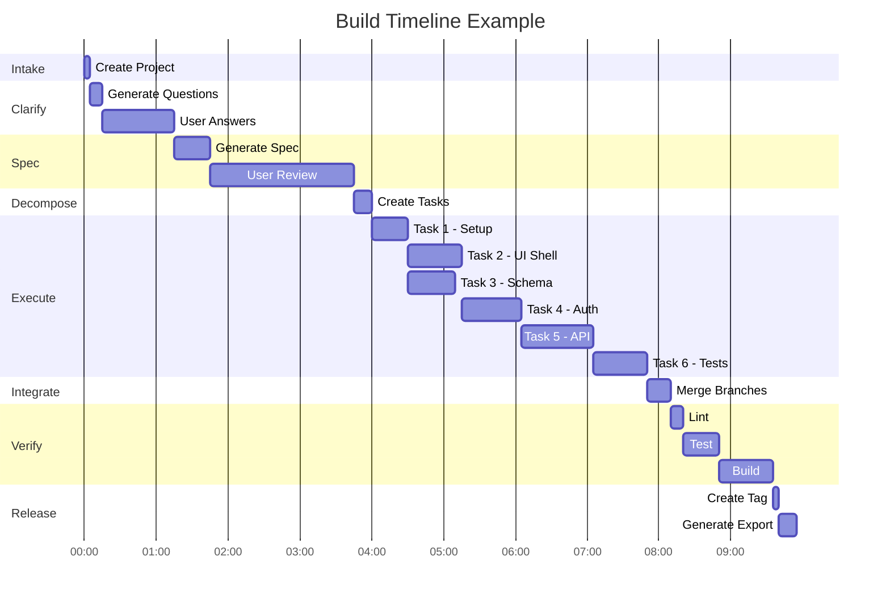

---

## Error Handling

### Retry Strategy

| Phase | Max Retries | Backoff |
|-------|-------------|---------|
| Task Execution | 3 | Exponential (5s, 10s, 20s) |
| Verification Fix | 3 | None |
| Merge Conflict | 2 | None |

### Failure Modes

| Failure | Recovery |
|---------|----------|
| Task timeout | Retry with extended timeout |
| Agent error | Retry with different prompt |
| Merge conflict | Automated resolution |
| Lint failure | Auto-fix task |
| Test failure | Debug and fix task |
| Build failure | Analyze and fix task |

### Manual Intervention

When automated recovery fails:
1. Run marked as `failed`
2. User notified
3. User can:
   - Retry entire run
   - Modify spec and rebuild
   - Export partial progress
   - Archive project

---

## Metrics & Observability

### Key Metrics

| Metric | Target |
|--------|--------|
| Time to first build | < 10 minutes |
| Build success rate | ≥ 90% |
| Task parallelism | 4+ concurrent |
| Verification pass rate | ≥ 95% |

### Events Emitted

Each phase transition emits events for real-time UI updates. See [Events Documentation](./EVENTS.md) for details.

---

## Related Documentation

- [Architecture Overview](./ARCHITECTURE.md)
- [Git Model](./GIT-MODEL.md)
- [Agent Execution](./AGENTS.md)
- [Event System](./EVENTS.md)
