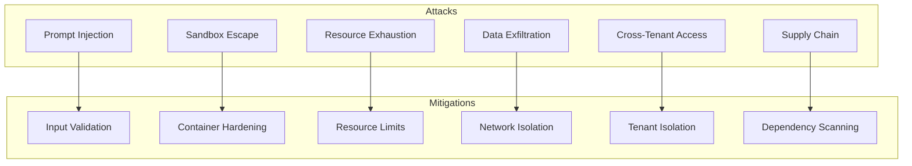
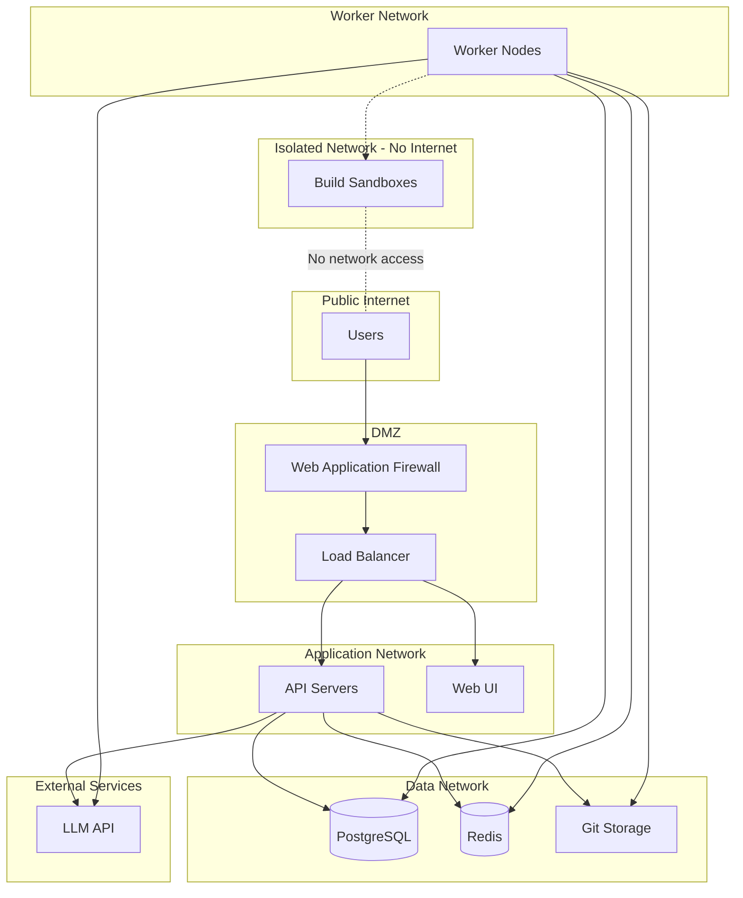
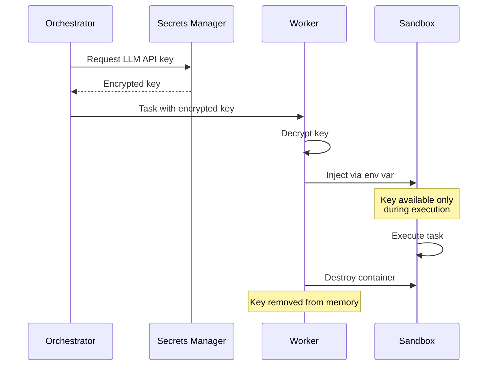

# Prazium Security Model

## Overview

Prazium executes AI-generated code, which must be treated as untrusted. This document defines the security boundaries, isolation mechanisms, and secret management practices.

## Security Principles

1. **Defense in Depth** - Multiple layers of security controls
2. **Least Privilege** - Minimal permissions for each component
3. **Isolation** - Strong boundaries between tenants and builds
4. **Auditability** - Complete logging of security-relevant events
5. **Fail Secure** - Default to deny on failures

---

## Threat Model

### Assets to Protect

| Asset | Sensitivity | Protection |
|-------|-------------|------------|
| User credentials | Critical | Hashed, never logged |
| API keys | Critical | Encrypted at rest |
| LLM API keys | Critical | Injected at runtime only |
| Source code | High | Isolated per project |
| Database | High | Network isolation |
| Build artifacts | Medium | Signed, checksummed |

### Threat Actors

| Actor | Capability | Mitigation |
|-------|------------|------------|
| Malicious user | Craft prompts to generate malicious code | Sandbox isolation |
| Compromised agent | Execute arbitrary code | Container restrictions |
| External attacker | Network-based attacks | Firewall, no public sandbox access |
| Insider | Access to infrastructure | Audit logs, RBAC |

### Attack Vectors



---

## Sandbox Isolation

### Container Security

```yaml
# Security-focused container configuration
security:
  # Run as non-root user
  user: 1000:1000
  
  # Read-only root filesystem
  readOnlyRootFilesystem: true
  
  # No privilege escalation
  allowPrivilegeEscalation: false
  
  # Drop all capabilities
  capabilities:
    drop:
      - ALL
  
  # Seccomp profile
  seccompProfile:
    type: RuntimeDefault
  
  # AppArmor profile
  appArmorProfile:
    type: RuntimeDefault
```

### Docker Run Security Flags

```bash
docker run \
  # Resource limits
  --cpus=2 \
  --memory=4g \
  --memory-swap=4g \
  --pids-limit=100 \
  --ulimit nofile=1024:1024 \
  
  # Network isolation
  --network=none \
  
  # Security options
  --security-opt=no-new-privileges:true \
  --security-opt=seccomp=/etc/prazium/seccomp.json \
  --cap-drop=ALL \
  
  # Filesystem
  --read-only \
  --tmpfs /tmp:size=1g,noexec,nosuid,nodev \
  
  # User namespace
  --userns=host \
  --user=1000:1000 \
  
  # Volumes (minimal)
  -v ${worktree}:/workspace:rw \
  -v ${agentRuntime}:/opt/agent:ro \
  
  prazium/agent:latest
```

### Seccomp Profile

```json
{
  "defaultAction": "SCMP_ACT_ERRNO",
  "architectures": ["SCMP_ARCH_X86_64"],
  "syscalls": [
    {
      "names": [
        "read", "write", "open", "close", "stat", "fstat",
        "lstat", "poll", "lseek", "mmap", "mprotect", "munmap",
        "brk", "rt_sigaction", "rt_sigprocmask", "ioctl",
        "access", "pipe", "select", "sched_yield", "mremap",
        "msync", "mincore", "madvise", "dup", "dup2",
        "nanosleep", "getpid", "socket", "connect", "sendto",
        "recvfrom", "sendmsg", "recvmsg", "shutdown", "bind",
        "listen", "getsockname", "getpeername", "socketpair",
        "setsockopt", "getsockopt", "clone", "fork", "vfork",
        "execve", "exit", "wait4", "kill", "uname", "fcntl",
        "flock", "fsync", "fdatasync", "truncate", "ftruncate",
        "getdents", "getcwd", "chdir", "rename", "mkdir",
        "rmdir", "creat", "link", "unlink", "symlink",
        "readlink", "chmod", "fchmod", "chown", "fchown",
        "lchown", "umask", "gettimeofday", "getrlimit",
        "getrusage", "sysinfo", "times", "getuid", "getgid",
        "geteuid", "getegid", "setpgid", "getppid", "getpgrp",
        "setsid", "setreuid", "setregid", "getgroups",
        "setgroups", "setresuid", "getresuid", "setresgid",
        "getresgid", "getpgid", "setfsuid", "setfsgid",
        "getsid", "capget", "capset", "rt_sigpending",
        "rt_sigtimedwait", "rt_sigqueueinfo", "rt_sigsuspend",
        "sigaltstack", "utime", "mknod", "statfs", "fstatfs",
        "sysfs", "getpriority", "setpriority", "sched_setparam",
        "sched_getparam", "sched_setscheduler",
        "sched_getscheduler", "sched_get_priority_max",
        "sched_get_priority_min", "sched_rr_get_interval",
        "mlock", "munlock", "mlockall", "munlockall", "vhangup",
        "pivot_root", "prctl", "arch_prctl", "adjtimex",
        "setrlimit", "chroot", "sync", "acct", "settimeofday",
        "mount", "umount2", "swapon", "swapoff", "reboot",
        "sethostname", "setdomainname", "ioperm", "iopl",
        "create_module", "init_module", "delete_module",
        "get_kernel_syms", "query_module", "quotactl",
        "nfsservctl", "getpmsg", "putpmsg", "afs_syscall",
        "tuxcall", "security", "gettid", "readahead", "setxattr",
        "lsetxattr", "fsetxattr", "getxattr", "lgetxattr",
        "fgetxattr", "listxattr", "llistxattr", "flistxattr",
        "removexattr", "lremovexattr", "fremovexattr", "tkill",
        "time", "futex", "sched_setaffinity", "sched_getaffinity",
        "set_thread_area", "io_setup", "io_destroy", "io_getevents",
        "io_submit", "io_cancel", "get_thread_area", "lookup_dcookie",
        "epoll_create", "epoll_ctl_old", "epoll_wait_old",
        "remap_file_pages", "getdents64", "set_tid_address",
        "restart_syscall", "semtimedop", "fadvise64", "timer_create",
        "timer_settime", "timer_gettime", "timer_getoverrun",
        "timer_delete", "clock_settime", "clock_gettime",
        "clock_getres", "clock_nanosleep", "exit_group", "epoll_wait",
        "epoll_ctl", "tgkill", "utimes", "mbind", "set_mempolicy",
        "get_mempolicy", "mq_open", "mq_unlink", "mq_timedsend",
        "mq_timedreceive", "mq_notify", "mq_getsetattr", "kexec_load",
        "waitid", "add_key", "request_key", "keyctl", "ioprio_set",
        "ioprio_get", "inotify_init", "inotify_add_watch",
        "inotify_rm_watch", "migrate_pages", "openat", "mkdirat",
        "mknodat", "fchownat", "futimesat", "newfstatat", "unlinkat",
        "renameat", "linkat", "symlinkat", "readlinkat", "fchmodat",
        "faccessat", "pselect6", "ppoll", "unshare", "set_robust_list",
        "get_robust_list", "splice", "tee", "sync_file_range",
        "vmsplice", "move_pages", "utimensat", "epoll_pwait",
        "signalfd", "timerfd_create", "eventfd", "fallocate",
        "timerfd_settime", "timerfd_gettime", "accept4", "signalfd4",
        "eventfd2", "epoll_create1", "dup3", "pipe2", "inotify_init1",
        "preadv", "pwritev", "rt_tgsigqueueinfo", "perf_event_open",
        "recvmmsg", "fanotify_init", "fanotify_mark", "prlimit64",
        "name_to_handle_at", "open_by_handle_at", "clock_adjtime",
        "syncfs", "sendmmsg", "setns", "getcpu", "process_vm_readv",
        "process_vm_writev", "kcmp", "finit_module", "sched_setattr",
        "sched_getattr", "renameat2", "seccomp", "getrandom",
        "memfd_create", "kexec_file_load", "bpf", "execveat",
        "userfaultfd", "membarrier", "mlock2", "copy_file_range",
        "preadv2", "pwritev2", "pkey_mprotect", "pkey_alloc",
        "pkey_free", "statx"
      ],
      "action": "SCMP_ACT_ALLOW"
    }
  ]
}
```

---

## Network Security

### Network Architecture



### Firewall Rules

```yaml
# Sandbox network policy
apiVersion: networking.k8s.io/v1
kind: NetworkPolicy
metadata:
  name: sandbox-isolation
spec:
  podSelector:
    matchLabels:
      app: prazium-sandbox
  policyTypes:
    - Ingress
    - Egress
  ingress: []  # No ingress allowed
  egress: []   # No egress allowed
```

### LLM API Proxy

Sandboxes cannot directly access the LLM API. Instead, requests are proxied through the worker:

```typescript
// Worker-side LLM proxy
class LLMProxy {
  private rateLimiter: RateLimiter;
  private validator: RequestValidator;
  
  async forward(request: LLMRequest): Promise<LLMResponse> {
    // Validate request
    this.validator.validate(request);
    
    // Rate limit
    await this.rateLimiter.acquire();
    
    // Forward to LLM API
    const response = await this.llmClient.complete(request);
    
    // Sanitize response
    return this.sanitize(response);
  }
}
```

---

## Secret Management

### Secret Types

| Secret | Storage | Injection |
|--------|---------|-----------|
| Database credentials | Environment variable | Container startup |
| Redis password | Environment variable | Container startup |
| LLM API key | Vault/Secrets Manager | Runtime injection |
| User API keys | Database (hashed) | Never exposed |
| Session secrets | Environment variable | Container startup |

### Secret Injection Flow



### Environment Variables

```bash
# API Server
DATABASE_URL=postgresql://...
REDIS_URL=redis://...
SESSION_SECRET=<random-32-bytes>
LLM_API_KEY=<from-vault>

# Worker
DATABASE_URL=postgresql://...
REDIS_URL=redis://...
LLM_API_KEY=<from-vault>

# Sandbox (minimal)
# LLM_API_KEY injected at runtime only
# No database access
# No Redis access
```

### Key Rotation

```typescript
interface KeyRotationPolicy {
  llmApiKey: {
    rotationInterval: '30d';
    gracePeriod: '24h';
  };
  sessionSecret: {
    rotationInterval: '7d';
    gracePeriod: '1h';
  };
  databasePassword: {
    rotationInterval: '90d';
    gracePeriod: '1h';
  };
}
```

---

## Authentication & Authorization

### Authentication Methods

| Method | Use Case | Implementation |
|--------|----------|----------------|
| Session cookie | Web UI | HTTP-only, Secure, SameSite=Strict |
| API key | Programmatic access | Bearer token, hashed storage |
| Admin token | Self-hosted admin | Environment variable |

### Session Security

```typescript
const sessionConfig = {
  name: 'prazium_session',
  secret: process.env.SESSION_SECRET,
  cookie: {
    httpOnly: true,
    secure: true,
    sameSite: 'strict',
    maxAge: 7 * 24 * 60 * 60 * 1000, // 7 days
    domain: '.prazium.com',
  },
  rolling: true,
  resave: false,
  saveUninitialized: false,
};
```

### API Key Security

```typescript
// Generate API key
function generateApiKey(): { key: string; hash: string; prefix: string } {
  const key = `pzm_${randomBytes(32).toString('base64url')}`;
  const hash = createHash('sha256').update(key).digest('hex');
  const prefix = key.substring(0, 8);
  
  return { key, hash, prefix };
}

// Validate API key
async function validateApiKey(key: string): Promise<User | null> {
  const hash = createHash('sha256').update(key).digest('hex');
  
  const apiKey = await db.apiKeys.findOne({
    where: { keyHash: hash },
    include: { user: true },
  });
  
  if (!apiKey || (apiKey.expiresAt && apiKey.expiresAt < new Date())) {
    return null;
  }
  
  // Update last used
  await db.apiKeys.update({
    where: { id: apiKey.id },
    data: { lastUsedAt: new Date() },
  });
  
  return apiKey.user;
}
```

### Authorization (Hosted Mode)

```typescript
interface Permission {
  resource: 'project' | 'run' | 'export' | 'deploy';
  action: 'read' | 'write' | 'delete' | 'admin';
}

const ROLE_PERMISSIONS: Record<string, Permission[]> = {
  viewer: [
    { resource: 'project', action: 'read' },
    { resource: 'run', action: 'read' },
  ],
  builder: [
    { resource: 'project', action: 'read' },
    { resource: 'project', action: 'write' },
    { resource: 'run', action: 'read' },
    { resource: 'run', action: 'write' },
    { resource: 'export', action: 'read' },
  ],
  admin: [
    { resource: 'project', action: 'admin' },
    { resource: 'run', action: 'admin' },
    { resource: 'export', action: 'admin' },
    { resource: 'deploy', action: 'admin' },
  ],
};
```

---

## Input Validation

### API Input Validation

```typescript
import { z } from 'zod';

const createProjectSchema = z.object({
  name: z.string()
    .min(1)
    .max(100)
    .regex(/^[a-zA-Z0-9\s\-_]+$/),
  description: z.string()
    .min(10)
    .max(10000)
    .transform(sanitizeHtml),
});

const submitAnswersSchema = z.object({
  answers: z.array(z.object({
    questionId: z.string().uuid(),
    answer: z.union([
      z.string().max(1000),
      z.boolean(),
      z.array(z.string().max(100)),
    ]),
  })).max(10),
});
```

### Path Validation

```typescript
function validatePath(path: string): boolean {
  // No path traversal
  if (path.includes('..')) return false;
  
  // No absolute paths
  if (path.startsWith('/')) return false;
  
  // No hidden files (except specific allowed ones)
  const allowedHidden = ['.env.example', '.gitignore', '.eslintrc'];
  if (path.includes('/.') && !allowedHidden.some(h => path.endsWith(h))) {
    return false;
  }
  
  // No sensitive files
  const forbidden = ['.env', '.env.local', 'id_rsa', 'id_ed25519'];
  if (forbidden.some(f => path.endsWith(f))) {
    return false;
  }
  
  return true;
}
```

### Command Validation

```typescript
const COMMAND_ALLOWLIST = new Set([
  'pnpm',
  'npm',
  'npx',
  'node',
  'tsc',
  'eslint',
  'prettier',
  'vitest',
  'git',
  'mkdir',
  'rm',
  'cp',
  'mv',
  'cat',
  'echo',
  'ls',
]);

function validateCommand(command: string): boolean {
  const parts = command.split(/\s+/);
  const baseCommand = parts[0];
  
  if (!COMMAND_ALLOWLIST.has(baseCommand)) {
    return false;
  }
  
  // No shell operators
  if (/[;&|`$()]/.test(command)) {
    return false;
  }
  
  // No redirects to sensitive locations
  if (/>\s*\//.test(command)) {
    return false;
  }
  
  return true;
}
```

---

## Audit Logging

### Logged Events

| Event | Data Captured |
|-------|---------------|
| User login | User ID, IP, timestamp, success/failure |
| API key created | User ID, key prefix, permissions |
| Project created | User ID, project ID |
| Build started | User ID, project ID, run ID |
| Export downloaded | User ID, export ID, IP |
| Admin action | Admin ID, action, target |

### Audit Log Schema

```sql
CREATE TABLE audit_logs (
    id UUID PRIMARY KEY DEFAULT gen_random_uuid(),
    timestamp TIMESTAMPTZ NOT NULL DEFAULT NOW(),
    actor_id UUID,
    actor_type VARCHAR(20) NOT NULL, -- 'user', 'system', 'api_key'
    action VARCHAR(50) NOT NULL,
    resource_type VARCHAR(50) NOT NULL,
    resource_id UUID,
    ip_address INET,
    user_agent TEXT,
    details JSONB,
    
    INDEX idx_audit_timestamp (timestamp DESC),
    INDEX idx_audit_actor (actor_id),
    INDEX idx_audit_resource (resource_type, resource_id)
);
```

### Audit Log Retention

| Environment | Retention |
|-------------|-----------|
| Self-hosted | Configurable (default: 90 days) |
| Hosted | 1 year |
| Enterprise | 7 years |

---

## Vulnerability Management

### Dependency Scanning

```yaml
# .github/workflows/security.yml
name: Security Scan
on:
  push:
    branches: [main]
  schedule:
    - cron: '0 0 * * *'

jobs:
  scan:
    runs-on: ubuntu-latest
    steps:
      - uses: actions/checkout@v4
      
      - name: Run Snyk
        uses: snyk/actions/node@master
        env:
          SNYK_TOKEN: ${{ secrets.SNYK_TOKEN }}
          
      - name: Run Trivy
        uses: aquasecurity/trivy-action@master
        with:
          scan-type: 'fs'
          severity: 'CRITICAL,HIGH'
```

### Container Image Scanning

```bash
# Scan agent image
trivy image prazium/agent:latest

# Scan for secrets
trufflehog filesystem --directory=.
```

### Security Headers

```typescript
const securityHeaders = {
  'Strict-Transport-Security': 'max-age=31536000; includeSubDomains',
  'X-Content-Type-Options': 'nosniff',
  'X-Frame-Options': 'DENY',
  'X-XSS-Protection': '1; mode=block',
  'Content-Security-Policy': [
    "default-src 'self'",
    "script-src 'self' 'unsafe-inline'",
    "style-src 'self' 'unsafe-inline'",
    "img-src 'self' data: https:",
    "connect-src 'self' wss:",
    "frame-ancestors 'none'",
  ].join('; '),
  'Referrer-Policy': 'strict-origin-when-cross-origin',
  'Permissions-Policy': 'camera=(), microphone=(), geolocation=()',
};
```

---

## Incident Response

### Security Incident Levels

| Level | Description | Response Time |
|-------|-------------|---------------|
| Critical | Active exploitation, data breach | Immediate |
| High | Vulnerability with exploit available | 4 hours |
| Medium | Vulnerability, no known exploit | 24 hours |
| Low | Minor security issue | 7 days |

### Response Procedures

1. **Detection** - Automated alerts or manual report
2. **Containment** - Isolate affected systems
3. **Investigation** - Determine scope and impact
4. **Eradication** - Remove threat
5. **Recovery** - Restore normal operations
6. **Lessons Learned** - Post-incident review

### Contact

Security issues: security@prazium.com

---

## Compliance Considerations

### Data Handling

| Data Type | Handling |
|-----------|----------|
| User PII | Encrypted at rest, minimal collection |
| Generated code | User-owned, exportable |
| Build logs | Retained per policy, deletable |
| Payment data | Not stored (Stripe handles) |

### GDPR Compliance (Hosted)

- Right to access: Export all user data
- Right to deletion: Delete account and all data
- Data portability: Export in standard formats
- Consent: Explicit opt-in for data processing

---

## Related Documentation

- [Architecture Overview](./ARCHITECTURE.md)
- [Agent Execution](./AGENTS.md)
- [Deployment Guide](./DEPLOYMENT.md)
- [API Specification](./API.md)
